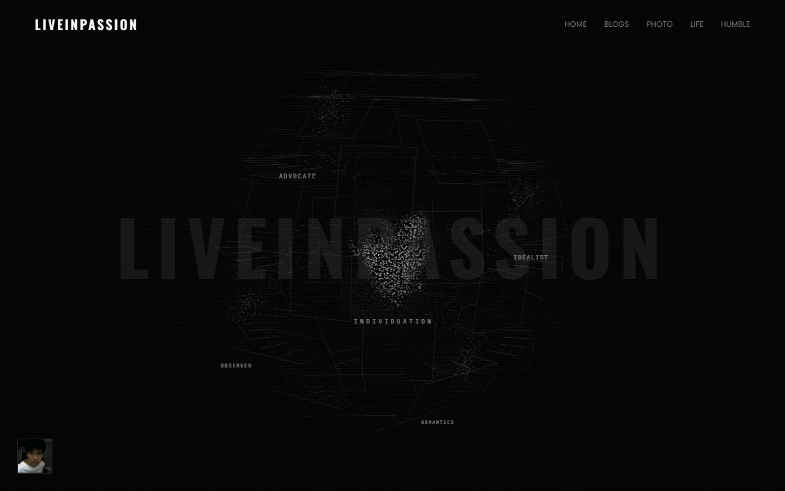
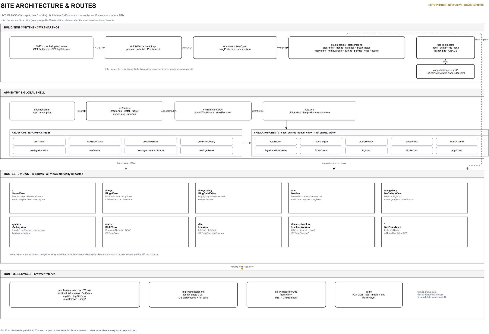
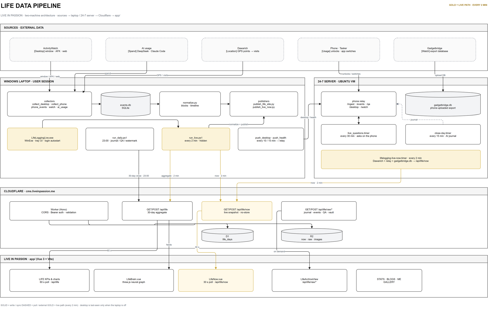

# LIVEINPASSION

**For Her.**

***

## 架构

## 链接

- 站点：<https://liveinpassion.me>
- 后台：<https://cms.liveinpassion.me/admin>
- 仓库：<https://github.com/HuangWeiLong-dot/liveinpassion>
- 架构图：[site-architecture.png](docs/site-architecture.png) · [life-pipeline.png](docs/life-pipeline.png)

***

## 更新记录

提交信息沿用既有规则：

- `update: N` —— 一批功能更新
- `fix: N.M` —— 同一批里的修复

从 `update: 29` 起，每个版本都写清具体改了什么；**此后每次 update / fix 提交都要在本节最上方
（紧跟这行说明之后）追加一条记录**。`update: 16–28` 按 git 历史补录；`update: 1–15` 是旧站
（单文件 `index.html`）时期，早期提交只写了版本号，这里按改动内容补主要节点。每个条目的日期
与 commit 一一对应。

### update: 101 — 2026-11-14

#### 后台编辑器加 Markdown Lint 面板与拼写检查

- 新增 `admin/src/utils/mdLint.js`：纯文本静态分析，不依赖编辑器实例，可以直接在
  Node 里跑。输入停下 400ms 后对正文跑一遍，结果列在 Lint 面板。
  语法规则只覆盖这套站点真正会写的结构：围栏代码、标题、链接/图片、HTML 块、
  表格、分页符。
- 拼写分两层：mdLint 查常见错拼（accomodate / definately / seperate…）与重复词
  （`that that`、`had had` 这类英文正常写法不报）；其余错字交给浏览器原生拼写检查
  —— BlogEdit 通过 `codeMirrorExtensions` 放开 CodeMirror 的 `spellcheck`，
  编辑器里直接画红下划线。
- 新增依赖 `@codemirror/view`（拿到 EditorView 以挂上拼写检查所需的 DOM 属性）。

### update: 100 — 2026-11-14

#### ME 电视新增 CH 04「THE CORRIDOR」+ 品牌 logo 入库

- **MeCorridor**：ME 页电视机的第四个频道。版面参照 inherited.band——六栏细线、
  超大字、卡片从幕布中揭开、非当前展位缩到 0.4 并淡出、说明行左右交错；
  每个展位是一块本站配色的色块（电视 RGB 的蓝 / 红，配纸白 / 近黑），不用任何
  自拍或博文照片。滚动竖向发生在电视屏幕内部，整屏背景用 clip-path 从底部推上来
  换场；底片池循环取 ECHOES 的环境封面。
- **品牌 logo 入库**：`logo/` 收下横版 / 竖排 / 纯 mark 三种形态、黑白两色共 6 个
  SVG，以及 logo-motion / time-mark 两个动效预览 HTML。
- **sketches/**：设计草图台（Sketch Desk）入库，集中放未采用的版面试验。
- **快照**：新文章入库（blogPosts +108 行），showcase 同步刷新。
- **杂项**：`.gitignore` 排除 `.trae-html-share-packages/`。

### update: 99 — 2026-11-14

#### 充电 / 不充电两套动效

- 不充电：水面 7 秒一个周期，平静缓慢，没有发光。
- 充电：水面加快到 2.2 秒、水里升起气泡、水面做明暗脉冲，状态标签变亮加粗。
- 气泡只在 `charging` 时渲染；`prefers-reduced-motion` 下全部关闭。

### update: 98 — 2026-11-13

#### 四格状态统一结构

- 电量格补回图标，和 Wi-Fi / 通知 / 解锁一致：图标 → 数值 → 标签。
- 去掉电量格单独的字号与 min-height，四格由 grid 自动等高；
  水位仍然铺满整格、文字压在它之上。

### update: 97 — 2026-11-13

#### 通知格子滚动真实消息

- 手机的通知格不再只显示数字：下面滚动最近 8 条真实通知（应用 + 正文），
  列表重复一份、`translateY(-50%)` 无缝循环，上下边缘渐隐。
- 数据来自 `/now` 新增的 `phone.notificationsRecent`。
- ⚠️ 通知正文是**别人发来的消息**，现在会出现在公开的 `/now` 上；
  `/life/archive` 的归档仍然删掉正文。

### update: 96 — 2026-11-13

#### 网络 / 解锁改成格内动效

- 按反馈不动图标：网络是横向扫光、解锁是从上往下的扫描线，
  都落在格子内部、低透明度；`prefers-reduced-motion` 下关闭。

### update: 94–95 — 2026-11-13

#### 电量：整格水位，去掉底边空白

- 整个格子就是电池，不画电池外形；水从左往右涨，
  右端竖浪与主体同色相接、不越界。
- 去掉整块上下浮动 —— 它会让底边露出 2px 空白，看起来像裂开。

### update: 89–92 — 2026-11-13

#### 歌词居中 + 实时滚动

- 歌词整块居中（poem 排版），当前行用 `transform` 位移恒定在容器中央，
  0.55s 平滑过渡；首屏数据一到就定位，不再停在顶部。
- 修复 `padding + scrollTop` 把容器实际高度撑到 324px、区块看起来是空的问题。
- `/now` 轮询 15s → 5s。

### update: 87–88 — 2026-11-13

#### 实时性

- 手机 App 播放中每 10 秒推一次位置，暂停/切歌立即推；站点 5 秒拉一次。
- 服务器的 live-now timer 从 2 分钟改成 20 秒，切歌不再等两分钟。
- 电量配色跟着主题走（`var(--text-primary)`），不再是固定蓝色。

### update: 86 — 2026-11-13

#### 歌词聚焦滚动

- 当前行放大（scale 1.06）并高亮，上下行按距离阶梯淡出（0.42 / 0.22 / 0.1），
  过渡 0.45s。
- 滚动改为 `scrollTo({ behavior: 'smooth' })` 并保持当前行居中；容器加上下渐隐遮罩。
- 同步 LIFE 面板说明：手机块与正在播放各占一整行。

### update: 85 — 2026-11-13

#### 手机面板：整格水位电量 + 隐藏滚动条

- 电量不再是电池图标：那一格本身从底部涨水，液面是持续横移的 SVG 波浪，
  高度随 `phone.battery.level` 平滑变化；充电时波浪加速、水面变亮并做明暗脉冲。
- 歌词区域隐藏滚动条（`scrollbar-width: none` + `::-webkit-scrollbar`），滚动仍然可用。

### update: 83 — 2026-11-13

#### 实时歌词

- `/now` 的 `phone.music` 增加 `lyrics`（LRC）、`playing`、`position` / `positionAt`。
- 歌词来自 LRCLIB（公开、免密钥），后端带缓存；按播放位置高亮当前行。
- 没有位置心跳时按「30 分钟内」估算，兼容旧版手机 App。

### update: 82 — 2026-11-13

#### NOW 面板重排

- 01–04 一排（位置 / 问答 / 桌面 / 手表）；05 PHONE 与 06 NOW PLAYING 各占一整行。
- 手机块显示电量 / 网络 / 通知 / 解锁四个状态瓦片，并列出通知最多的应用。
- 正在播放块放大封面（132px）、歌手、曲名、专辑与播放统计。

### update: 79–80 — 2026-11-13

#### 音乐详情与封面

- 音乐卡片补歌手 / 专辑 / 时长与「今日播放次数」。
- 专辑封面由手机 App 以 96×96 JPEG base64 提供，NOW 卡片直接渲染；
  公开归档里会删除封面，避免一天几十首把 archive 撑大。

### update: 77–78 — 2026-11-13

#### 图标系统与长文本排版

- 新增 `LifeIcon.vue`：位置 / 问答 / 桌面 / 手机 / 手表 / 音乐 / 通知 / 电量 /
  Wi-Fi / 信号 / 屏幕等线性图标，NOW 卡片、状态 chip、Dashboard 与手机详情统一使用。
- Dashboard 的 NOW 行：状态列可伸缩并允许换行，长歌名不再撑破格子。

### update: 74–76 — 2026-11-13

#### 手机状态上站

- Worker 的 `PHONE_KEYS` 接受 `battery` / `network` / `music` / `notifications`，
  并加范围校验（电量 0–100、分钟 ≤ 1440、列表长度上限）。
- NOW 面板手机卡片显示电量、Wi-Fi / 移动网络、通知条数与充电状态。
- 音乐区分「正在播放」与「今日最后一首」（30 分钟新鲜度）。

### fix: 73.2 — 2026-11-09

#### 响应式设备上隐藏左下角头像

- ≤1024px 一律隐藏 `.author-tower`，头像只保留在右上角汉堡菜单的
  `.nav-tools__avatar` 里（菜单展开时可见，44×44）。
- 旧规则 `.author-tower { display: none }` 权重不够，被桌面端兜底用的
  `html.echoes-locked .author-tower` / `html.blog-detail-open .author-tower`
  的 `display: block` 反压，导致 ECHOES ARCHIVE 与详情页在手机 / 平板上
  仍会露出左下角头像；改为 `html .author-tower { display: none !important }`。
- 桌面端（>1024px）行为不变：首页、ECHOES、详情页仍显示左下角 Ava 塔。
- 同步 CMS 内容快照（新增第 55 篇）。

### fix: 73.1 — 2026-11-08

#### ECHOES 在 `/echoes/` 下点封面不跳转

- 根因：GitHub Pages 会把 `/echoes` 落到 `/echoes/`，而列表页跳转守卫硬比
  `route.path === '/echoes'`。点封面后 240ms 的判断误以为已经离开列表，直接取消跳转，
  飞行层却留在屏幕上，封面看起来"停住不动"。
- ECHOES 相关的路径判断统一改用路由名 `echoes`：`BlogsView` 的两处跳转守卫、返回落点
  watcher，`App.vue` 的飞行层 watcher，`useCoverFlight` 的导航守卫。
- 中断分支补 `hideCoverFlight()`，避免飞行层残留。
- `tools/verify-cover-flight.mjs` 新增 `/echoes/` + 切换分类后点封面的回归断言。
- 同步 CMS 内容快照（分类改为 ROMANTIC / IDEALIST / OBSERVER / ADVOCATE）。

### update: 73 — 2026-11-08

#### Echoes 导出分页 + 分块清单

- `GET /api/posts/export.md` 新增 `offset` / `per_page`（`page` / `per_page` 等价），
  单页上限 200 篇；正文头部显示当前区间与总字符数，响应头带
  `X-Total-Count` / `X-Export-Start` / `X-Export-Count`（并暴露给跨域调用）。
- 新增 `GET /api/posts/export/manifest.json`：按约 24k 字符把已发布文章切成连续块，
  每块给出 `url / from / to / count / chars / titles`，并附每篇的单篇导出地址。
  AI 逐块抓取，不会再因为一次输入太大在中途被截断。
- `GET /api/posts/index.json` 增加 `fullExport` 与 `manifest` 地址；`llms.txt` 增加
  分块清单入口和 `page` / `per_page` / `offset` 用法。
- 逻辑测试：分页、越界、筛选后分页、单篇导出、manifest 连续性 / 块大小 / 块 URL
  可回读，共 24 项通过。

### update: 72 — 2026-11-08

#### Admin 分类 / 标签：多选批量归类

- Taxonomy 页下半部分新增文章列表：搜索、按分类 / 标签筛选、单篇勾选与「全选可见」。
- 批量操作：统一设置 CATEGORY（可选已有分类，或「＋ New category…」现场新建）、
  批量加标签（逗号 / 换行分隔，一次可多个）、批量移除某个标签。
- Worker `PUT /api/admin/taxonomy/posts`：一次最多 500 篇；只改
  `status='published'`，不存在的 id 静默跳过；没有实际变化不写库；有改动才触发
  Pages 重建。
- `GET /api/admin/taxonomy` 现在返回完整已发布文章列表（slug / 标题 / 分类 / 标签 /
  发布时间，按时间倒序）+ `total`，页面据此筛选与多选。
- 分类 / 标签没有独立实体，「新建」= 把它写给选中的文章。
- 验收脚本 `tools/verify-admin-taxonomy.mjs` 同步批量路径。

### update: 71 — 2026-11-08

#### Admin 分类 / 标签管理 + 首屏预载 v2

- **Admin Taxonomy 页**（`/taxonomy`，导航 05）：列出已发布文章的 CATEGORY / TAG 计数，
  支持 Rename、Merge（合并到已有名字）、Delete；分类删除后文章退回 `UNFILED`，
  标签删除则从每篇里移除。只统计、只修改 `status='published'` 的文章，草稿不受影响；
  每次改动后触发 Pages 重建。
- **Worker** `routes/taxonomy.js`：`GET /api/admin/taxonomy` + 分类 / 标签的
  `PUT`（重命名 / 合并）与 `DELETE`；名字走 body（分类 / 标签是自由文本，可能含 `/`）；
  UPDATE 时再校验一次 `status='published'`，避免读写之间文章被取消发布时误改草稿。
- **首屏预载 v2**：默认改为 LIVE + QUICK —— 只等前 30 张（展示 + 最近封面）就放行，
  剩余后台继续下；LIVE 下新增 `PATIENT / NOT PATIENT`（FULL / QUICK）范围选择，
  FULL 等全站或 45s 上限。新增 `SKIP — ENTER NOW`，任何时候都能先进站。
  存储键升到 v2（`lip:first-screen-preload-v2` / `...-mode-v2`），旧选择不迁移。
- **预载视觉**：已下载的封面在字背后拼成一颗圆形球（越下越多、越显）；底部读数显示
  `百分比 · 完成/总数 · 预计剩余秒数`；滚动的问题改为按钮，点一下暂停、再点继续。
- **Admin 移动端导航**：手机隐藏编号的规则补上 `.nav-item` 前缀（原来被更高特异性的
  基础规则压住，多出一截编号）；导航项变多后主题按钮不再被 flex 压窄。
- **相册管理**：从删除按钮 / 输入框起手不启动长按拖拽（`preventDefault` 会吞掉 click）。
- **内容快照**：CMS 分类整理落地（UNFILED → HER，PHIL / PSYCH / HER 标签）。
- **验收脚本**：新增 `tools/verify-admin-taxonomy.mjs`；`verify-admin-mobile` /
  `verify-cover-flight` / `verify-preload-progress` 同步新行为。

### update: 70 — 2026-11-08

#### 刷新过场 + 全站预载进度 + Hero 球层级

- **刷新过场**：首次进站仍是 `LIVEINPASSION + ENTER`；之后刷新不再出现 ENTER，
  页面正中随机显示一句大写问题（`data/brandQuestions.js`，11 句，连续两次不重复），
  约 900ms 后自动走同一套上浮 / 回落动画进站。`localStorage['lip:visited']`
  与 cookie `lip_visited` 双写，强刷清掉 localStorage 也还能认出老访客。
- **全站图片预载**：选 `LIVE IN PASSION` 点 ENTER 时先把全站图片拉完再进场
  （`composables/useSitePreload.js`，替代原来 ≤14 张的 `useFirstScreenWarmup`）：
  首页展示、全部博客封面、全部相册照片、好友照片、影片海报，并发 8、45s 上限；
  超时先放行，剩余继续在后台下载。默认改为 **NOT**（不预载），选择记在
  `lip:first-screen-preload`。
- **字上进度条**：预载进度画在首屏大字上 —— `--brand-progress` 通过
  `background-clip: text` 从左到右填实；loading 期间底板不淡出、操作区隐藏，
  字下方滚动显示那组问题（reduced-motion 下静止）。
- **页面转场小字问题**：转场板子底部新增一行随机问题，从下方 22px 淡入，
  与标题逐字动画并行。
- **Hero 球层级**：3D 球移到主体之上（`z-index: 6`，与背景字同层靠 DOM 顺序
  压在下面），但自身 `pointer-events: none`；拖拽改由 Hero 根节点接，从主体 /
  人格 / 链接 / 按钮上起手时不拖。
- **ME 灯箱打开等待解码**：大图还没解码时盒子尺寸为 0，不再直接放弃飞行，
  而是逐帧等它出现（最多 60 帧）；飞行层停在墙上那一格，不会出现「飞行没起来」。
- **验收**：新增 `tools/verify-preload-progress.mjs`（默认 NOT 不预载、LIVE 进度
  中间态、482 张全站请求、100% 后才入场、刷新过场自动进站，15/15）；
  `verify-enter-no-music` 同步改为每次 load 前清 `lip:visited`，全部通过；
  `verify-cover-flight` 43/43。

### update: 69 — 2026-11-08

#### 首屏预载选择 + 飞行层打断收尾 + ECHOES 视图切换

- **首屏预载选择**：品牌遮罩新增 `LIVE IN PASSION / NOT LIVE IN PASSION` 小选项
  （存 `localStorage['lip:first-screen-preload']`）。选前者点 ENTER 时，借首屏动画的
  时间窗预下 ≤14 张接下来最可能看到的图（首页 CURATED、ECHOES 最近封面、摄影/画廊
  前几张）；与站内 `` 用同一个 `anonymous` CORS 模式，避免缓存键分裂。选后者不预载。
- **首页 Showcase 等图就绪再出场**：不再以 `entered` 为开关，改为「品牌遮罩退场 +
  面板里真实 `` 全部 load/decode」后才从右侧滑出（8s 超时兜底）；卡片图改
  `eager` + `anonymous`。面板宽度抽成 `--hs-w`，收起动画中内容不重排，标题不会中途换行。
- **转场板子长标题排版**：标题按词分组、词内逐字，折行只发生在词间；每个字形
  `flex-shrink: 0`，不再被横向压扁；按长度分 `is-long` / `is-xlong` 两档收字号。
- **飞行层打断收尾**：新增 router `beforeEach` 守卫（`installCoverFlight`，注册在转场
  守卫之前），导航确认前按「模式 + slug」判断这趟飞行是否仍合法，浏览器后退 / 点导航
  立刻收层；`App.vue` 的 route watcher 同步改成同一判据。详情入场飞到一半按 Esc 时用
  `setCoverFlightMode('exit')` 接管同一趟飞行；从首页 CURATED 进入的详情按 Esc 走普通
  返回（不挂幕布、不起飞行层），回 HOME 后 header / 左下角 Ava 不再消失。
- **灯箱换页自动收起**：`Lightbox` / `MePhotoLightbox` 监听路由，离开当前页时关闭灯箱
  并收掉飞行层（ME 页是 keep-alive，否则回来还开着）。
- **ECHOES 视图切换柔化**：VIEW 抽屉切视图改为「淡到本页底色 → 换视图 → 淡回」
  （190ms，reduced-motion 直接切），右侧缩略图换图用 0.38s 交叉淡入。返程落点改用
  `.is-flight-target`，只藏落点图，入场来源格不再提前藏（修首次点击闪灰框）；
  导航被拦 / 用户 240ms 内离开时取消待跳转。
- **验收**：`tools/verify-cover-flight.mjs` 新增返程落点图隐藏、CURATED → 详情 → Esc、
  入场中途后退 / 去 HOME、灯箱飞行中换页、点击后立刻离开等断言（43/43 通过）；
  `verify-home-showcase` 19/19。
- **内容快照**：CMS 精选列表同步（移除两条旧 Echo）。

### update: 68 — 2026-11-08

#### Echoes 全文导出 + llms.txt

- Worker 新增公开只读 `GET /api/posts/export.md`：只含已发布文章，输出带
  标题 / 日期 / 分类 / 标签 / slug / URL 和正文 Markdown 的单文件；支持
  `category` / `tag` / `since` / `limit` / `slug` 查询参数，便于 AI 分批分析。
- 新增 `GET /api/posts/index.json`：仅元数据索引，方便 agent 先选文章。
- 站点构建生成 `llms.txt`：列出全文导出、索引、分类入口和用法，AI agent 可自动发现。
- 导出与索引都带 `Access-Control-Allow-Origin: *`，只读取 `status='published'`，
  不包含草稿。

### update: 67 — 2026-11-08

#### HOME SHOWCASE 手机右侧抽屉 + ECHOES WORLD 说明栏

- **手机 / 平板 HOME SHOWCASE 改为右侧抽屉**：≤1024px 不再用底部横条 + INDEX 底部抽屉
  （会压住全局页脚、和左下角 Ava/说明挤在一起）。与桌面共用同一块面板：默认收起成右边缘
  竖标签，点标签展开、头部「–」收起；手机上首次进入默认收起，收发状态仍记在
  `localStorage.homeShowcaseCollapsed`。底部横条与 `.hs-sheet` / `.hs-backdrop` 退役。
- **ECHOES WORLD 说明栏移到左下角**：`ECHOES — WORLD VIEW / ENTRIES / DRAG...` 从右上角
  VIEW 按钮下方改到左下角（桌面在胶片条上方，手机在列表底部留白里），不再和展开的
  缩略图叠在一起；同时去掉 `CLASS B` / `TYPE` 这类占位假元数据。
- **内容快照**：同步 CMS 新文章《NO IT IS NOT》（`no-it-is-not`）与首页 LATEST ECHO。
- **验收脚本**：`tools/verify-home-showcase.mjs` 同步新行为（右侧贴边、不贴底、
  竖标签收起 / 展开、手机无横向溢出）。

### update: 67 — 2026-11-08

#### CMS：现有 Tag 可选

- 文章编辑页的 Tags 下方新增一排**现有标签**建议（从后台所有文章去重、排序）；
  点一下加入当前文章，再点一下移除；已选中的标签保持反色状态。
- 仍然可以手输标签；上限 12 个、大写归一化不变。

### update: 66 — 2026-11-08

#### ECHOES 分类导航 + 归档信息 + 正文尾标签

- **ARCHIVE 左上角分类导航**：分类 tab 从 CMS 文章数据动态去重（ALL + 实际分类），
  不写死白名单；CMS 里给文章新增 / 改名 / 删掉分类，重建后 tab 自动变化。
  点击切换筛选，URL 同步 `?cat=`，可与 `?view=archive` 一起分享。
- **ARCHIVE 右栏信息**：显示 `CATEGORY`、`DATE`、`READ` 和 `TAGS` 标签胶囊。
- **详情页标签**：从标题下移到正文最下方（书页模式接在书页之后），
  保留居中排版、hairline 分隔和标签点击筛选；分类仍显示在日期/阅读时长一行。

### fix: 65.2 — 2026-11-08

#### 修复详情渲染与封面飞行中断

- **恢复 `safeTags`**：详情模板引用它，缺失会抛 `TypeError`，详情进不去，
  封面飞行层自然也会停在半路。补回后详情分类 / 标签与封面飞行恢复。
- **飞行层中途退出收尾**：详情飞行途中按 Esc / 点空白时，飞行层还是
  `mode='enter'`；返回列表现在会接回任意仍活着的飞行层（不再只认 `'exit'`），
  落到对应卡片后隐藏，不会卡在屏幕上。

### fix: 65.1 — 2026-11-08

#### 封面飞行残影 + 详情页分类 / 标签恢复

- **CoverFlight 残影**：详情页进入时若飞行层没有被接管（直接打开 / slug 不匹配 /
  被中断），立刻 `hideCoverFlight()`；返回列表时若不是详情返回的飞行，也直接收掉；
  兜底超时从 6s 收到 2.5s。封面不会再停在屏幕上。
- **详情页 Category / Tags**：标题下恢复分类与标签行（书页模式下常驻可见），
  分类显示在日期/阅读时长一行；标签仍可点击跳 ECHOES ARCHIVE 并挂筛选。
- **内容快照**：同步 CMS 最新分类 / 标签（`life-is-a-fantasy` → ANNIVERSARY，
  LIFE / FILM / PSYCH / PHIL）。

### update: 65 — 2026-11-08

#### CMS：删除保护 + 已发布文章安全更新

- **删除保护**：Posts / Albums / 照片 / Films 的 Delete 先弹出确认框，要求输入
  作者生日（`2007-05-25`）才执行；确认框全英文。
- **已发布文章 Update**：编辑已发布文章时显示 `Update`（只改 Category / Tags /
  标题 / 封面，不动正文）和 `Save changes`（正文 + 元数据）；两者都触发前台重建，
  但**不改 `published_at`**，历史编号与排序保留。
- **Worker**：已发布文章的 PUT 自动触发 Pages 重建；PATCH status 重新发布 /
  取消再发布时保留原 `published_at`，只有首次发布才写入当前时间。
- **Admin 文案**：Showcase / Films 剩余的中文描述改为英文。

### update: 64 — 2026-11-08

#### 早期文章回填 Markdown + 管理端图标统一 + 飞行层 CORS 修复

- **6 篇早期文章回填 Markdown**：`0010_legacy_html_to_md.sql`——这些文章是
  `content_format='html'`、`content_md=NULL`，后台 Markdown 编辑器打开是空的，
  改动保存不到正文。把 HTML 转成 Markdown 写进 `content_md` 并切到 md 格式；
  只补空值、不动 `content_html`，线上仍是旧渲染，直到后台各保存一次。
- **AdminIcon**：管理端统一 Tabler 风格线性 SVG 图标组件，替换 + / − / × / ✓
  字符按钮；App / AlbumManage / BlogEdit / FilmManage / ShowcaseManage 同步接入。
- **飞行层与预取的 CORS 修复**：CoverFlight 的 `` 与 useRouteProgress 的预取
  统一 `crossorigin="anonymous"`，对齐站内卡片 / 详情 / 灯箱的 CORS 模式——否则
  同一个 URL 会被浏览器当成两份缓存键，预取白做、飞行时再下再解一遍。
- **ARCHIVE 序号固定**：改为全站时间序号（最早发布 = 01，最新 = 最大号），
  筛选 / 滚动 / 无限轨道复位都不再改变编号（此前用的是行号，筛选后会变）。
- **杂项**：`.gitignore` 排除 `.screenshots/`（验收工具截图输出）。

### update: 63 — 2026-11-08

#### CoverFlight：全站唯一一块封面飞行层

- 新增 `CoverFlight.vue` + `useCoverFlight.js`：一块 Teleport 到 body 的 fixed 元素
  （没有 transform 祖先），统管所有"列表 → 详情 → 列表"与"缩略图 → 灯箱 → 缩略图"
  的封面飞行。两个端点只负责给矩形：列表在点下去时交出封面、返回时量出**当前**
  目标格；详情 / 灯箱挂上后量出终点，飞完再把图交还给自己的 ``。
- 取代 `useCoverHandoff` 的 sessionStorage 矩形交接——旧方案里列表与详情是两棵 DOM，
  换页那一帧比例 / object-fit / hover 缩放都可能变，看起来就是一下"跳"；退出时也
  拿不到"现在的卡片在哪"，切篇 / 改窗口 / 无限轨道复位都会落偏。
- 生命周期：`beginCoverFlight()` → 可选 `liftCoverFlightTo()`（列表淡出的 240ms 里
  先轻微起势，避免"点下去先愣一下"）→ `animateCoverFlightTo(dest)` → 同帧
  `hideCoverFlight()` 并显示目标自己的封面。灯箱落地时若大图未解码完会多等一拍，
  揭示动画挪到落地那一刻再演；图始终是同一张（同一个 URL），不会闪出第二份请求。
- ECHOES ⇄ 详情专用这一份飞行层：路由离开 `/echoes`（点导航、浏览器跳转）立即收掉，
  不让它浮在下一个页面上。各灯箱（Lightbox / MePhotoLightbox）与 GALLERY / ME GALLERY /
  PHOTOGRAPHY / PROJECTION 的缩略图来源矩形同步接入。
- BlogBook 随之大幅简化（净 -500 行左右，交接逻辑全部上移）；新增验收脚本
  `tools/verify-cover-flight.mjs`。

### fix: 62.1 — 2026-11-07

- `/projection` 直连 404：路由与页面在 update 62 里上线了，但 SEO 三处注册被漏掉——
  `copy-static.mjs` 的静态路由清单、`meta.js` 的 `STATIC_PAGES` 与 `pathOf`。
  补上后构建会生成 `dist/projection/index.html`（预渲染 head），sitemap 收录该页。

### update: 62 — 2026-11-07

#### 评级系统整体移除 + 首页 SHOWCASE + 路由进度条

- **移除评级**：`0008_remove_rating.sql` DROP `rating_json` 与 `cover_rating_json`；
  worker 删掉 `normalizeRating` / `ratingToStored` 与所有读写；admin 移除「Author's Rating」
  与「Cover Rating」编辑块、列表评级列；前台移除详情页鉴定章与封面评分角标；
  快照不再含 rating / coverRating。update 60 的"只留英文"被这一步取代——与其改文案，
  不如整个拿掉。
- **HOME 右侧 SHOWCASE**：`0009_home_showcase.sql` 建 `films` / `showcase_items` /
  `showcase_settings` 三表；worker 新增 `routes/showcase.js`（admin CRUD + public 聚合）
  与 `lib/showcase.js`（统一卡片形状：kind / title / meta / image / href）。
  首页右侧悬浮 LATEST ECHO / LATEST PHOTO / SELECTED，手机上收成底部横条；
  fetch-content 同步拉取 `showcase.json` 快照。
- **FILMS 影片库**：worker `routes/films.js` + admin FilmManage —— 影片元信息
  （slug / 标题 / video_key / poster_key / 跳转 path / 发布状态）入库管理，
  视频本体仍直传 R2 `films/` 前缀；《The Projection》作为首条记录随 0009 登记。
- **路由进度条**：新增 RouteProgress 组件 + `useRouteProgress` + `routeAssets` ——
  点导航那一刻开始预取目标页首屏图片，条子走的是真实完成比例而非定时器；
  注册顺序必须在 installPageTransition 之前，否则要等转场板子走完才开始下载。
  省流 / 2G 下退化为纯导航指示器。
- **杂项**：`seo/meta.js` 的 articleSection 兜底把 UNFILED 归为 'Echo'；
  验收脚本新增 verify-projection / verify-route-progress / verify-home-showcase。

### update: 61 — 2026-11-07

#### PROJECTION：短片《The Projection》的独立放映页

- 新增 `/projection`（导航 `FILM`）：整页是一台复古电视机（沿用 ME 页的机身语言），
  标题卡 → 正片 → 回标题卡两个状态都在屏幕里完成。
- 片源上传到 R2：`films/the-projection.mp4`（134 MB 原片直连，支持 Range，可拖动）。
  仓库里不放视频。
- 屏幕只负责显示：标题卡上只有 `THE PROJECTION`（按字母拆开，进场时一道光从左扫到右，
  13 个字母依次淡入）。机身下沿是扁平实体键：上一集 / 播放暂停 / 下一集｜复古分段
  进度条（可点、可拖、可用方向键）｜停止 / 全屏 / 音量刻度尺（收音机调频式，左右拖，
  带 `VOL 80` 读数）；只有一部片子，上一集/下一集暂时禁用。
- 进片不换版式：影片直接在电视机屏幕里播，头部和四周都不动。
- 片子本身混得极轻（平均 −39 dB），用 Web Audio 补 +12 dB；音量旋钮调的是这个增益。
- 唯一的动态光是跟着鼠标走的镜头光晕：指针甩得快时亮一下再衰减，像镜头扫到阳光。
  没有彩色光斑、没有自动扫过的耀斑、没有游走鬼影；屏幕里是高噪点颗粒 + 扫描线。
- 进片时头部、左下角 Ava 塔、音乐播放器与歌词层一起让开；进站点 ENTER 起播的站点音乐
  在这一页暂停。自定义控制条（播放 / 进度 / 静音 / 全屏 / 退出），快捷键 Space / Esc / M / F；
  keep-alive 失活自动暂停。
- 新增 `tools/verify-projection.mjs`：电视在、标题在屏幕正中、字母入场、光晕跟随鼠标、
  外壳让开、播放与 Esc、1100px 导航不撞 LOGO、手机不溢出、零 console 报错。

### update: 60 — 2026-11-06

#### 去掉中文评价

- ARCHIVE 的小字短评与详情页鉴定章只保留英文评语（此前中英并排）。

### update: 59 — 2026-11-06

#### 封面评分、自由分类、标签胶囊，封面交接补漏

- **封面评分**：`0007_cover_rating.sql` 给 posts 加 `cover_rating_json`，与正文自评完全独立，
  只存 `score` / `grade` / `verdict`；grade 仍由后端从分数重算（阈值同上）。posts 的
  新建与局部更新、public 列表与详情都带上 `coverRating`。Admin 新增 `08 / Cover Rating`
  折叠块（分数 + 一句 verdict）；前台详情页在封面右上角钉一枚鉴定章（等级 / 分数 / verdict），
  叠在图上、不挡点击。
- **分类改为自由文本**：`normalizeCategory` 不再走白名单 —— 早期版本会把作者自定义的分类
  静默改成 UNFILED。现在只做大小写 / 空白归一化与 24 字符截断，空值才落 UNFILED。
  Admin 把 select 换成输入框（`maxlength=24`），下方列出「文章里已用过的分类」作建议签；
  ARCHIVE 的分类 tabs 也改为固定常用项 + 实际出现过的自定义分类，`?cat=` 直接接受任意值。
- **标签改成胶囊输入**：Enter / 逗号成 tag，点击整块移除，退格删最后一个；未按 Enter 的草稿
  保存时自动收进列表。上限 12 个、单个 24 字符，与后端归一化一致。
- **Admin 修复与收敛**：新文章 `rating` 初值改为完整对象（`null` 会让 `/blogs/new` 模板里
  `form.rating.score` 直接白屏）；编辑器里 `note` 字段改为英文多行 textarea；底部提示、
  登录失效文案、boot 兜底页统一改成英文；评分块样式对齐 CMS 的直角 / 细边框 / mono 风格；
  列表序号改为按时间顺序（最早 = 01，最新 = 最大号）。补 `900px` 断点。
- **封面交接补漏**（`useCoverHandoff` / `BlogDetailView`）：图还没解码时 `` 是 0×0，
  旧逻辑直接 return，导致详情页硬切、按 Esc 也没有落点 —— 现在退回卡片 / 相框那一格量尺寸；
  同时把 `naturalWidth/naturalHeight` 带过去，详情媒体盒一开始就按真实比例撑开，
  消除 632px → 379px 的盒子瞬跳。打字机逻辑加「代次」计数，换篇 / 退场时正在分批拆字的
  循环立即收工，不会把半套 span 继续塞进 DOM。标签行移到正文末尾做成落款，打字期间不显影，
  并改用站点真实色板（`--border` / `--text-secondary`），修掉 `--fg` 未定义导致的 0px 边框。
- **视图切换**：右上角改为带真实作品缩略图的抽屉（LOOKBACK / WORLD / ARCHIVE 各一张，
  随浏览位置变化），点选后强制收回；从 ARCHIVE 切走先播整页退场再换视图。ARCHIVE 里
  打开一篇不再硬跳，直接复用 LOOKBACK 的封面 FLIP。

### update: 58 — 2026-11-06

#### ECHOES：博客分类 / 标签 / 作者自评 + ARCHIVE 卷轴，BLOGS 改名

- **CMS**：`0005_post_meta.sql` 给 posts 表加 `category` / `tags_json` / `rating_json`
  三列与分类索引；`0006_echo_seed.sql` 按 slug 给 49 篇文章回填分类、标签与评级。
  远端两批内容实际已执行过，本次把迁移记录补登记进 `d1_migrations`。
- **Worker**：新增 `src/lib/meta.js` 统一归一化规则 —— 分类白名单
  （POEM / ESSAY / LOG / CRITIQUE / FRAGMENT / LETTER，其余兜底 UNFILED）、标签大写去重
  （≤12 个、每个 ≤24 字符）、评级 grade 由 score 重算（S≥9.0 · A≥8.0 · B≥7.0 · C≥6.0），
  不信任前端传的 grade。posts 路由支持新字段的写入与局部更新（没传保留、显式 null 才清
  评级）；public API 的列表与详情都返回 category / tags / rating。
- **Admin**：BlogEdit 新增 Category 下拉、Tags 输入（逗号/空格分隔，保存前归一化）与
  「Author's Rating」折叠块（score + 四维 + verdict EN + note 中文，只有开关打开且有分数
  才提交）；BlogList 行内显示分类徽标与评级（S 9.1 这种格式）。
- **改名**：路由 `/blogs` → `/echoes`、`blog-detail` → `echo-detail`；旧地址由 router
  重定向接管，且 `copy-static.mjs` 为 `/blogs` 与每篇旧文章生成 meta refresh 跳转页
  （canonical 指新址、noindex、保留 query/hash），让搜索权重迁到 /echoes。导航、
  SiteStats、pageLabels、RSS 同步改名；localStorage 的 `blogs-view` 自动迁移到
  `echoes-view`。
- **ARCHIVE 视图**：BlogsView 新增第三种浏览方式 —— 分类 tabs + tag 筛选的作品卷轴，
  VIEW 按钮改为 LOOKBACK → WORLD → ARCHIVE 循环；详情页新增标签行（点击跳 ARCHIVE
  带筛选）与钉在封面墙底边的评级鉴定章（grade / 分数 / 四维）。BlogPosting 结构化数据的
  `articleSection` 改用真实分类，面包屑加分类层。
- **MeView**：移除 EXPLORE 无限照片回廊（-1059 行），这一页只剩 CRT 电视一屏，不再有
  纵向叙事、滚动锁与自动推进。

### update: 57 — 2026-11-04

#### BLOGS 版面适配：49 篇封面不互插、矮屏还高度给卡片

- `BlogWorld.vue` 的环上卡片宽度除了 `13.5vw`，再加一道「相邻弧长 − 12px」的上限
  （`arcWidth` 由件数算出，经行内 `--bw-arc` 传给 CSS 的 `min()`）。文章数涨到 49 篇后，
  宽屏上 210px 的封面会插进邻居；现在件数变多只会把卡片收窄一点，几何自己保持缝隙。
- `BlogsView.vue` 新增 `max-height: 820px` 断点：字标上边距 122→90、巨号标题 5.2rem、
  `--jb-rail` 收到 `clamp(48px, 12vh, 132px)`。常见 720/768 高笔记本上，卡片不再被压成
  97px 的扁带；≤560 高仍交给原有的矮视口规则。
- `main.css` 在 `html.blogs-lookback` 下隐藏左下角头像塔：LOOKBACK / WORLD 整页铺满卡片，
  1280×720 实测头像与卡片下缘重叠 41px，也压住底部 rail 的编号；离开本页即恢复。

### update: 56 — 2026-11-04

#### 博客正文在构建期做 SEO 增强

- 新增 `app/src/seo/enhanceBody.js`，在 `fetch-content.mjs` 写入快照前处理每篇文章，
  四件事都幂等：正文 `<h1>` 降为 `<h2>`（文章标题已经是页面 H1）、给 h2–h6 补稳定
  anchor id（重名自动加序号）、图片按 figcaption 或「标题 + 序号」补 alt 并补
  `loading=lazy` / `decoding=async`、统计 `wordCount / readingMinutes / keywords`。
- 关键词取正文词频前 6 个，跳过停用词、长度不足 3 与缩写；标题里出现的词权重 ×2。
- 拉取失败时不再只保留旧快照，也会把本地快照就地增强一遍，兜底版本同样带 SEO 字段。
- `meta.js` 的 BlogPosting 结构化数据补 `wordCount`、`timeRequired`、`keywords` 与
  `articleSection`；老快照缺字段时按正文实时兜底。`blogPosts.json` 快照同步写入增强
  后的正文与统计。

### update: 55 — 2026-11-03

#### SEO：每个真实 URL 都有静态 head，深链接不再靠 404 兜底

- `app/src/seo/meta.js` 把「路由 + CMS 快照 → title / description / canonical / OG /
  Twitter / JSON-LD」算成纯数据；运行时 `composables/useSeo.js` 在 `router.afterEach`
  写进 `<head>`，构建脚本复用同一份，静态页与 JS 写入不会出现两套说法。
- `copy-static.mjs` 为静态页、博客 slug、摄影人名与 LIFE 归档各生成
  `<path>/index.html`（本次 65 页）：深链接在 GitHub Pages 上返回 200，并把
  title / description / OG / JSON-LD 预渲染进 HTML，不执行 JS 的爬虫也能读到；
  未知路径仍交给 `404.html`（`noindex`）。
- 同时生成 `sitemap.xml`（65 条，带图片扩展）、`robots.txt` 与 `feed.xml`（RSS，
  48 条）；canonical 只取 path，忽略 `?view=corner` 这类查询参数，避免同一内容被算成
  两个 URL。JSON-LD 覆盖 WebSite / Person / BlogPosting / BreadcrumbList / ImageGallery。
- 首页 `index.html` 补齐 author / robots / theme-color / og:locale，预连接
  `cms.liveinpassion.me`；`HeroConcept` 主体图改 `eager + fetchpriority=high` 并写死
  960×1280，博客详情封面同样 `fetchpriority=high`；首页补一个 `sr-only` 的真实 H1
  （可见字标是逐字动画，对读屏无用）。

#### 灯箱：去掉「窗口飞到大图」的过渡

- 删除 `usePhotoFlight.js`。打开 / 关闭改成整块淡入淡出，照片就地在灯箱舞台上做一次
  故障揭示（缓存命中时手动补一次，同一张图不重复播）；原来的飞行克隆在大图还没解码
  时只是点击图的一张替代品，落地再换回真图反而会闪。
- `MePhotoLightbox` 同步去掉飞行与模糊缩略图占位（`thumb / reserve / origin` 三个
  props 一并移除），只保留 `decode()` 与大图淡入；关闭的 0.4s 淡出里保留 `src`，
  避免中途摘掉 `src` 闪出破图图标和 alt 文字。

#### 胶卷条与缩略图

- 底部胶卷条不再挂空 `src` 的 ``：缩略图没生成好时铺一块同色淡斜纹占位
  （`.win-strip__ph`），拿到再淡入；生成失败隔 2s / 4s 重试两次，解码失败就丢弃回
  占位。`thumbUrl` 失败不再写进缓存，一次网络抖动不会让这张图整个会话都加载不出来。
- 顺带修一批 alt 文案（画廊、ME、摄影、博客卡片）。

#### 文档

- 根目录新增 `README.md`：项目概览、页面路由、技术栈、架构与部署说明，并把
  `CHANGELOG.md` 的全部记录并入「更新记录」一节（`CHANGELOG.md` 删除）；配一张
  首页截图 `docs/screenshots/home.png`。

### update: 54 — 2026-11-03

#### 新板块 PHOTOGRAPHY：按人名分组的摄影作品

- 新增 `/photography` 与 `/photography/:person`，沿用 GALLERY 的窗户墙：入场
  （`useWallEntry`）、悬停倾斜与故障揭示（`useCardFx`）、空窗格 / 洞、方块光标热区、
  灯箱都直接复用。索引页一扇窗一个人名（封面 + 名字 + 张数），详情页一扇窗一张
  照片；窗格改成 4:3 横窗、8 列，缩略图走 `useThumbnails`（索引 800px、详情 360px），
  触屏没有 hover 时名字常显。
- 索引与详情是同一个组件实例（keep-alive 不按 fullPath 重建），所以 watch
  `isDetail / activePerson` 重新准备缩略图并重播入场；品牌遮罩落定后 1.4 秒才入场。
- 顶部导航在 BLOGS 与 LIFE 之间加 PHOTO；屏幕中央的板块名走 `pageLabels`：索引
  PHOTOGRAPHY，详情用人名大写，查不到就退回路由段。

#### CMS 与数据：photography 相册

- `0004_photography_albums.sql`：`albums.kind` 增加 `photography`，新增 `person` 列。
  SQLite 改不了 CHECK 约束，迁移里先把照片备份到无外键的 `photos_backup`，再依次删
  child / parent，最后按新结构恢复 —— 不能直接 DROP albums，`foreign_keys` 开启时
  会顺着 ON DELETE CASCADE 把照片记录一起删掉。
- Worker：创建 / 更新相册接受 `person`（photography 必填，且 `r2Prefix` 必须以
  `photography/` 开头）；`person` 存去掉空格的路由段，展示名仍走 `name`；公开
  `/albums` 返回 `person`，老相册为 null。
- 后台新建相册多一个 Photography 类型与 Person 字段：填人名自动把 R2 Prefix 拼成
  `photography/<人名>`，上传写进 `photography/<人名>/<yyyyMM>/`；人名留空会被拦下。
- 构建快照同步：新增 Han Yong 的摄影相册；博客快照补上三篇新文（Next to Me / Rain? /
  Upward）。

### update: 53 — 2026-11-01

#### CMS 换皮：深色优先，一套和前台同源的设计系统

- 默认深色（`#1A1A1A` 底、`#FAFAFA` 字、1px `#333` 线），浅色保留原来那套；
  `cms-theme` 存 localStorage，`index.html` 在首帧前把 `dark` 类写到 `<html>`，
  白屏兜底块也跟着主题，深色下不再先闪一块白。顶栏右侧新增日 / 月按钮切换。
- Oswald 大写宽字距 + Poppins 300 正文，新增 JetBrains Mono 承担元信息；零圆角、
  1px 发丝线、悬停反色。整套样式抽到 `admin/src/styles/admin.css`，`App.vue` 只剩壳层。
- md-editor 的样式与 js-xss 配置从 `main.js` 挪进编辑器路由：列表页与相册页不再
  加载编辑器（构建里 BlogEdit 单独 388KB，列表 3.4KB）。

#### 页脚：前台同款抽屉 + 原生 WebGL 字标

- 巨型 LIVEINPASSION 固定在视口底部、被内容盖住，滚到文档末尾占位让开才露出来，
  下面仍是三句 Be。扭曲用原生 WebGL 等价重写（15×15 位移贴图、指针按速度注入、
  每帧 ×0.88 衰减），不再为页脚引入 three（约 600KB）。
- 只在页脚进入视口时跑 RAF，离开即停；WebGL 不可用回退 HTML 字标；主题切换后
  重画字标贴图，Oswald 字体就绪后再画一次。

#### 三个页面

- **顶栏**：固定 80px，滚动超过 4px 才落一条发丝线（rAF 节流）。
- **Posts**：表格换成编号行 —— 序号、封面、标题 / 摘要 / 日期 / 阅读时间；封面只取
  `coverKey`（压缩版），没有就显示 NO COVER，不把原图封面拉进列表；顶部统计
  Posts 与 Published；日期按 D1 的 UTC 字符串换算成北京时间显示。
- **Albums**：左边是相册索引（编号、名称、`r2Prefix · kind`），右边是选中相册的
  照片墙。
- **编辑页**：字段编号 01–04（Card Title / Title / Slug / Cover），封面有空态与
  换 / 删操作；正文编辑器独立成面板，底部动作条带 Ctrl+S 提示。预览增强的监听
  改挂在稳定的 `.md-editor` 根上，手机切到预览或预览被重建时都不会丢。

#### 登录页与开发环境

- Worker 的自建登录页改成跟随 `cms-theme` 的深浅配色，`color-scheme` 一并声明；
  仍然零外部依赖、纯表单提交。字标、编号与页脚标注重排。
- `admin/vite.config.js` 把 Miniflare 的临时目录收进项目内（`admin/.tmp-miniflare`，
  已加进 `.gitignore`）：本机工作区带低完整性标签时，workerd 写系统临时目录会
  `CreateDirectory: access denied`，收进项目内即可正常起 dev。

### update: 52 — 2026-11-01

#### 上传：去掉 20MB 上限

- Worker 的 `uploadImage` 删掉 `MAX_SIZE = 20 * 1024 * 1024` 的体积校验，并一并
  去掉它的导出；类型判断不变（只收 jpg / png / webp，按文件头嗅探）。大图不再被
  「Image too large」挡掉，实际上限回到 Cloudflare Worker 的请求体大小限制。
- admin 端不变：相册、博客封面与正文图仍先经 `compressImage` 压一版再传，只是
  原图超过 20MB 时不会再在服务端失败。

#### 左下角 Ava 塔：让开胶卷条与页脚

- GALLERY / MY GALLERY 的 92px 胶卷条由 Teleport 挂在 body 上，Ava 塔原本 32px 的
  底距会让 64px 的头像整块压在条里。`body:has(.win-strip)` 时把整座塔抬到
  `calc(92px + 16px)`，与条留 16px 的缝；规则放在 `@media (min-width: 1025px)` 里，
  窄屏本来就没有胶卷条这条底栏。
- 页脚抽屉拉开（`html.footer-revealed`）时，淡出名单补上 `.author-tower`：塔和
  GALLERY 的统计 / 筛选条、胶卷条、播放中的歌词行一起让位，不再挡住页脚最下面
  那三句 Be；往上滚一格抽屉合上，它们自己就回来。

### update: 51 — 2026-11-01

#### ME：照片变成被风吹着的纸片，整页落在一台复古 CRT 电视

- **纸片**：30 张照片不再正面平推。每张纸有自己的初始倾角、风向、相位与风速：
  推进时持续扇动（三轴轻微旋转）、横向 `skew`、顺风向漂移，再叠一圈随时间起伏的
  `clip-path` 旗帜轮廓（上下边缘轻微鼓动、右侧自由边来回摆）；贴近镜头的最后
  500px 按深度淡出，不再整块突然消失。
- **EXPLORE**：进来时照片全部隐藏、页面锁在起点；点 EXPLORE 后先来一段 1.8 秒的
  「阵风」（风速先大后小），照片按深度从近到远逐张浮现（easeInOut），1.5 秒内
  全部浮完，镜头才开始推进；这期间用户一动滚轮就取消自动推进。
- **推进距离 12000 → 10000px**：最远一张在约 55% 进度时也飞过镜头，保证照片清空
  之后电视才升上来，不会出现「电视和照片同框」。
- **一台电视，三个频道**：原来的 ME / GALLERY / FRIENDS 三个独立窗口收进一台方角
  复古 CRT：首屏只播 ME，机身下沿的按钮切换频道；切换时先出 20fps 的雪花花屏
  （只用中低灰阶，避免整屏纯白刺眼）加一两道横向撕裂，雪花最强时换内容再退场。
  机身是中性灰塑料，上沿右侧写 where are you my love? / searching for meaning，
  下沿只保留有实际功能的按键和 GitHub / X。
- 跨 900px 断点重建舞台：桌面端 GSAP 会把电视设成透明的，直接切到窄屏布局会留下
  一台看不见的电视。reduced-motion 与 ≤900px 没有隧道可飞，EXPLORE 直接落到电视；
  SKIP 仍可跳过隧道。

#### 首页背景：封面墙换成 3D 球，可拖成十二面体

- **56 个节点**：非人格博客的封面（最多 28 张）按 fibonacci 均匀铺在球面上、正面
  朝外，尺寸与深度带一点点确定性随机（纯等大会像点阵）；球外套一层经纬线框
  （210 段 1px 的 div）。整颗球缓慢自转（Y 1.6°/s、Z 0.45°/s），指针在空白处按住
  可拖动、松手带惯性；触屏只保留自转。这层只是底纹：去色、压暗、不承载点击。
- **球体 ↔ 十二面体**：拖拽滑动超过 6px 后松手、或滚轮在球上停下 650ms（累计超过
  12°），整颗球用 900ms 在两种排布之间变形 —— 每张卡飞到十二面体的 20 个顶点之一
  （56 张循环坐 20 个角，会成簇），经纬线框交叉淡换成 30 条棱。56 个节点的补间
  逐帧直接写 `transform`，不走 Vue 重渲染，结束才把终值写回响应式；经度取较短的
  那条弧，避免有卡片绕大半圈。
- **滚轮只在球体半径内归球**：指针在球外的空白处照常滚页面；Ctrl + 滚轮留给浏览器
  缩放不抢；每格滚轮先归一到像素再限幅，触控板一划不会把球甩出半圈。
- **封面不进首屏请求**：点 ENTER 才开始取 28 张 CDN 封面，接下来 2.4 秒的开场正好
  给它们预热，开场落定后按序号错开一张张淡入（快网络不会挤成一团，慢网络也不会
  乱序）。关掉背景球会停自转，重新打开再点起来。
- **指针拖迹**：新增 `composables/useCursorTrail.js` —— 指针每帧朝目标缓动 35%，
  沿路径每 6px 记一个点、最多保留 1500px，线段按位置从 50% 不透明度渐隐到 0；只画
  单色自由曲线，和方块光标共用墨色。只在首页、精确指针、非 reduced-motion 下开。
- **兜底**：开场循环没起来（极慢的机器 / IO 认为 Hero 不在视口）时，INTRO\_MS 之后
  检查一次并直接落到终态，球不会永远停在透明态；回首页统一先回顶部，再补开场与
  揭示；离开首页停拖迹、收掉还没松手的球体拖拽。

#### 左下角：作者区改成「Ava 塔」（桌面）

- 头像常驻，指针停在头像上（或键盘 focus 进来）后，GitHub / X / 主题 / 音乐 /
  （首页）背景开关从它后面往上滑出，离头像越近越早（40ms 一档）；塔身底部和头像
  叠 8px、中间没缝，指针往上走不会误触发收起。
- 滑出的那一下用和照片同一套「Bayer 抖色 + 逐行揭示」：`useCardFx` 新增
  `playGlitchRevealCanvas(host, source)`，接受调用方给的底图 —— 把塔里的按钮按
  1/2 位图画成一张快照（位置一律用 `offset*`，滑出途中不会把半路的位置画进底图），
  再交给同一套揭示动画。触屏设备没有 hover，塔保持常开。
- 背景开关只在首页的那座塔里出现；换页 / 卸载收起塔并清掉故障层。

#### ≤1024px：底部 Dock 撤掉，那批控件收进右上角汉堡

- 删除 `MobileDock.vue`、`ThemeToggle.vue`、`useEdgeReveal.js`：桌面端控件在左下
  的 Ava 塔，窄屏统一进 `AppHeader` 的 `nav-tools`（头像 / X / GitHub / 主题 /
  音乐 / 背景开关）。汉堡带 `aria-expanded`，任意动作执行后自动收起。
- 头部导航去掉 STATS 与 ORG 两个入口（统计并在 LIFE，组织页挂在 ME 下）；窗口墙
  与相册页原先给 Dock 让位的底部 padding 一起收掉（`win-dock` 回到距底 16px，
  胶卷条在 1024 以下仍隐藏），ORG 页正文的 Dock 让位也去掉。
- 悬浮件的旧引用一并清掉：`BlockCursor` 的热区名单、`BlogsView` 退场渐隐名单、
  灯箱 / 详情页注释、`App.vue` 的逐个淡入与边缘滑出。

#### LIFE：新增 STATS 视图（原 /stats 并入 LIFE）

- 顶部视图切换由两个变三个：FEED / DASHBOARD / STATS，选择存 `lifeViewMode`、
  地址带 `?view=stats`；旧 `/stats` 重定向到 `/life?view=stats`。LIFE 在 keep-alive
  里，已经挂载过就不会再跑 setup，`LifeView` 额外 watch `route.query.view` 跟着走。
- 新组件 `SiteStats.vue` 搬自原 `StatsView`：去掉自己的 hero（大标题 / 视图切换 /
  彩色开关都由 LIFE 外壳提供），保留 60 秒轮询与 GSAP 入场，用 `props.active`
  在 keep-alive 切走时停表。删除 `StatsView.vue` 与 `/stats` 路由。
- stats 视图的 hero 副标题换成 `Who passes through Live in Passion`，日期 / 城市 /
  TODAY · LIVE 那行 meta 只在 LIFE 的两个视图显示；换视图统一回顶部，免得停在
  页面中段看到半截内容。
- ORG 改挂 ME 下：路由 `/me/organization`（name `me-organization`），旧
  `/organization` 重定向过去；页面标签与全局页脚排除名单同步。

#### LIFE 面板：睡眠 / 天气 / 饮食 / 覆盖率 / 心率

长页与仪表盘共用这五个新图（仪表盘走 `compact` 迷你形态），缺数据时一律留缺口
或显示空态，不画成 0。

- **SLEEP WINDOW（01）**：每天一条「入睡 → 起床」的浮动区间，均值线标平均入睡
  时刻；数据是从手机 / 电脑静默**推断**的（手表没有睡眠传感器），随行带
  `basis` / `confidence`，手填的那天另一样式。没有信号的那晚是缺格。
- **WEATHER（09）**：低温 → 高温区间带 + 底部降水条，均值线；空态写明天气采集
  默认关闭 —— 它是唯一会把粗化坐标（约 1km）发给第三方 Open-Meteo 的源。
- **NUTRITION（10）**：热量柱 + 蛋白 / 碳水 / 脂肪侧栏；窗口内记录不足 60% 时
  先出提示「平均只描述记了的那几天」，空态写清飞书一行日志的写法。
- **DATA COVERAGE（11）**：9 个源 × 窗口天数一格，判据是**字段在不在**（没数据是
  null 不是 0），缺的格子留空；chips 给 WINDOW / FULL COVERAGE / WEAKEST。
- **HEART RATE（12）**：每天一条 min → max 区间带 + 均值点，右侧按星期几摊开
  七行；空态说明这是手表当天实际测到的范围，不是静息心率估算。
- 长页编号重排到 01–14（雷达仍是 00，GitHub 13、归档 14），仪表盘相应后移；
  三张新图在没有数据时**保留面板本身**，只显示空态 —— 少一块会让整页编号错位，
  也分不清是「这个源没开」还是「页面坏了」。

#### Worker：`/api/life` 接受三类新字段

- `sleep`：`onset` / `wake` 必须是 `HH:MM`（不接受日期或时区后缀），`hours` 0–24，
  `basis` / `confidence` 是短名称。
- `weather`：`tempMax` / `tempMin` ±60、`precipMm` 0–1000、`sunshineMin` 0–1440、
  `windMax` 0–500，`condition` 短名称；不含坐标。
- `nutrition`：`calories` 0–20000、`proteinG` 0–2000、`carbsG` 0–3000、`fatG`
  0–2000、`meals` 0–20，`confidence` 短名称。每顿的原文不进聚合。
- 三类都走字段白名单 + 可选数值；整天为 `null` 表示那天没有采集，前端据此留缺口。

#### 验证与修复

- `tools/verify-life.mjs`：桩数据补上睡眠 / 天气 / 饮食（故意每隔几天缺一次），
  断言面板数 10 → 15、均值线 3 → 7、覆盖率 9 个源、心率右侧 7 行星期、睡眠缺口
  有 `is-missing` 标记；空数据下 15 个面板仍在。
- `useCardFx` 的故障揭示改用**第一帧自己的时间戳**作起点：rAF 回调拿到的时间可能
  早于调度时的 `performance.now()`，`t` 变负数会让 `Uint32Array.set` 抛
  `RangeError`，绘制循环当场断掉、故障层永远挂在卡片上；`t` 同时钳到 0。
- `BlogWorld` 的环调低灵敏度：拖拽 0.28 → 0.1、滚轮 0.12 → 0.04、松手惯性
  0.1 → 0.035（同一比例），小幅滑动不再把环甩出去。
- Worker 登录页整套改英文（`lang`、标题、错误提示、按钮、aria-label）。
- 新博文 `CONTEMPLATING`（2026-10-31 23:27）。

***

### update: 50 — 2026-10-30

#### GALLERY / 主灯箱：胶片条、骨架屏与日期滚动

- **底部胶片条**：GALLERY 与 MY GALLERY 多一条固定在底部的 92px 胶卷条，列出当前
  筛选（或月份）下墙上的照片；点一张直接飞进详情。滚轮竖向增量映射成横向滚动，
  到两头就把滚轮交还页面；缩略图复用 `thumbUrl` 的 200px 缓存，不额外解码大图。
  条子只在两个相册页驻留（离开即收起），1024 以下隐藏以免和 MobileDock 打架；
  主灯箱与 ME 单图灯箱的舞台都按 116px 给它让位。
- **主灯箱改成骨架屏 + 舞台定尺寸**：舞台宽高按照片比例算出来（打开时的飞行落点、
  骨架屏、大图共用同一个矩形），切图不再跳版；`img.decode()` 把解码移出主线程，
  加载期间盖一块 GPU `transform` 的 shimmer 骨架。
- **照片日期**：文件名里的 `YYYY.MM[.DD]` 解析成照片日期挂在照片下方；切图时旧日期
  向上、新日期从下滚入（reduced-motion 下直接落位）。ME 单图灯箱同步接上这一行。
- **修**：ME 相册快照里同一张图有原名与 hash 别名两条记录，墙面和胶片条会并排出现
  同一张照片 —— 按图片地址在数据层去重。

#### BLOGS 的 WORLD 视图（参照 oumahi.art 的作品环）

- 封面沿一条 CSS 3D 圆柱排成一圈（`perspective` + `rotateY` / `translateZ`，无 WebGL），
  拖拽 / 滚轮转动、松手带惯性、空闲时极慢自转；点一件压暗世界并展开大图 + 右侧信息栏，
  ← → 换件，CLOSE / ESC 收起。
- 右上角 VIEW 按钮在 LOOKBACK / WORLD 之间切换，选择存 `localStorage`、URL 也带
  `?view=world`；原轨道只是被盖住，滚动位置与图片缓存都还在，切回来原地继续。
- 环心那枚 LIVEINPASSION 与首屏同一套字号 / 字距，钉在圆心并往屏幕深处推：
  前半圈封面在它前面、后半圈在后面，转动时有真正的遮挡层次。
- 说明栏（ENTRIES / DRAG·SCROLL·CLICK·A PIECE）排在 VIEW 按钮正下方、右对齐成一列。
- 900px 以下环收成纵向索引，不叠第二套 3D。

#### 卡片语言统一（`composables/useCardFx.js`）

- 三处卡片（GALLERY 墙 / ME 墙 / WORLD 封面）统一：1px 直角发丝边、悬停才跑的
  8px 黑白行军蚁描边、静态去色压暗、悬停恢复彩色并把放大放在内部图片上
  （整卡不缩放，边框与描边不会跟着抖）。
- 指针跟随的轻微 3D 倾斜只写两个 CSS 变量，墙 / 环 / 灯箱各自在自己的 transform 里接；
  只在细指针 + 非 reduced-motion 下生效。
- 图片解码完成时来一次「Bayer-8 抖色 + 逐行抖动」的故障揭示：低分辨率画布叠在卡片上，
  前缘 9 行做像素错位与红蓝分离，约 1s 后淡出交还真实图片；GALLERY / ME / WORLD /
  两种灯箱 / 博客详情封面都接同一套。跨域图片读不到像素时静默跳过。
- 所有动效都遵循 `prefers-reduced-motion`。

#### 性能：画面不变，主线程开销更低

- **故障揭示**：已揭示区与抖色区在创建时预计算成两张 32 位像素表，逐帧只做整行拷贝，
  只有前缘 9 行逐像素 —— 灯箱大图从每帧十几万次像素运算降到几十次整行拷贝。
- **倾斜**：卡片矩形在指针进入时量一次（滚动 / 缩放时失效），不再每帧
  `getBoundingClientRect` 强制回流。
- **WORLD 逐帧循环**：缓动按 dt 折算（120 / 144Hz 上不再比 60Hz 快一截）；
  拖拽 / 滚轮只在 rAF 里写一次 transform；展开层停稳后停循环（读字时不再每帧
  重算那层模糊背景）；空闲自转约 30fps 更新，转速本身不变。
- **相册墙**：`loadedSrcs` 与胶片条缩略图按帧合批，一帧里到的几十张只触发一次重渲染；
  指针提示的跟随也走 rAF。
- **CSS**：行军蚁动画只挂在悬停 / 正面那张上，骨架屏两条动画只在灯箱激活且骨架未隐藏
  时跑 —— 几十个元素挂无限动画、关掉灯箱后还在逐帧走的那笔开销没了。
- **其他**：照片飞行盒子加 `contain: layout paint`；灯箱的比例探针与舞台大图共用
  CORS 缓存，不再重复下载 / 解码。

#### 其他修复

- 页脚抽屉拉开时，底部那批固定件（Dock、GALLERY 筛选条与胶片条、正在播放的歌词）
  先淡出，不再压在页脚那三句 Be 上。
- `BlogDetailView` 的页面滚动锁改到 `onDeactivated` 释放：这一页在 keep-alive 里，
  离开时 `onBeforeUnmount` 不会跑，原来会把整站的滚动一直锁死。

***

### update: 49 — 2026-10-29

#### GITHUB ACTIVITY 改成年初至今（48 的补充）

- **格子图从 12 周扩到整年**：公开事件接口只能回溯 90 天，画不出「从 1 月 1 日开始」，
  所以贡献数据改走 `github-contributions-api.jogruber.de/v4`（CORS 放开、一次给满全年、
  自带 GitHub 的 0–4 级）。窗口从 1 月 1 日所在那一周开始到本周；1 月 1 日之前的半列
  和本周里今天之后的几天都不画框、不进统计。日历接口拿不到时退回原来的 12 周画法，
  脚注标 `CALENDAR UNAVAILABLE · LAST 12 WEEKS`，不会变成一整片空白。
- **蛇**：照 GitHub snake 的走法沿格子蛇形爬，头经过有活动的格子就吃掉（本轮变空），
  到终点停一下再来；指针停在格子上 / 面板滚出视口 / reduced-motion 时不推进。
- **格子图下方补齐**：BUSIEST DAY / BUSIEST WEEKDAY / AVG PER ACTIVE DAY / LONGEST RUN
  四个数字，再下面是 BY MONTH 的月度柱（带 PEAK 月份），把原来蛇图下面那块空洞填满。
- **右栏保持纯文字**：TOP REPOSITORIES 去掉进度条，只留序号 / 仓库名 / 事件数；
  最近动态也放回右栏，和仓库榜同一种列表形态 —— 左栏已经有格子图和月度柱，
  右栏再来一根根条子不协调。
- **修：LIFE 整页空白**：旧缓存缺少 `avgPerActiveDay` 时 `.toFixed` 抛错，把整个
  LifeView 的渲染带崩。缓存键升到 `v4` 并校验形状（`cells` / `totals` / `monthly`），
  组件里也改成 `Number.isFinite` 兜底显示 `—`。
- 验收：`tools/verify-github-activity.mjs` 换成全年 fixture（308 格 / 3 格 outside /
  3 格 future / 月份刻度 / 0–4 级分布 / 蛇推进与悬停暂停 / 普通视图不染成分类色 /
  刷新命中缓存 / 手机横向滚动、格子保底 9px / 日历失败退回 12 周 / 两个源都失败的空态 /
  reduced-motion 无蛇）。

***

### update: 48 — 2026-10-29

#### 新板块 GITHUB ACTIVITY（长页 + 仪表盘都有）

LIFE 里多了一块 GitHub 的公开动态：贡献格子图 + 合计 + 仓库排行。

- **数据**：GitHub 公开事件接口 `api.github.com/users/HuangWeiLong-dot/events/public`，
  不需要 token，也不经过 Worker。未鉴权限 60 次/小时/IP，所以结果缓存在
  `localStorage`（10 分钟），模块级单例让长页 / 仪表盘共用一份；切视图、刷新都不会重复请求。
  403/429 时退避 15 分钟，有缓存就继续显示并标 `CACHED`，没缓存才显示 `RETRY`。
- **格子图**：12 列（周）× 7 行（星期）= 84 格，按当天事件量分 0–4 级深浅；
  未来几天不画框。悬停 / 聚焦任意一格，下面那行读出当天的 commits / PRs / issues。
  公开事件接口最多覆盖约 90 天，窗口按「本周一往前 11 周」对齐，header 写实际天数。
- **合计**：COMMITS / PULL REQS / ISSUES / EVENTS / ACTIVE DAYS / STREAK（长页 6 个，
  仪表盘收成 4 个）。PushEvent 的提交按 sha 去重（翻页会重叠），合并提交没有
  commits 时按 1 次算；连续天数沿用 GitHub 口径（今天没活动从昨天起算）。
- **仓库排行**：只列窗口内碰过的仓库，按事件数排序，名字直接链到 GitHub；
  底部 `OPEN PROFILE` 出去。
- 位置：长页里排在 WEEKDAY PROFILE 之后、THE ARCHIVE 之前（08 / 09）；
  仪表盘里是 13 号格子，ARCHIVE 顺延成 14。
- 验收：`tools/verify-github-activity.mjs`（84 格 / 未来格数 / 今天格 / 7 行星期 /
  月份刻度 / 0–4 级分布 / 合计数字 / 仓库数 / 悬停读数 / 切换视图不重新请求 /
  刷新命中缓存 / 手机不横向溢出 / 403 时的 RETRY 与退避、零控制台报错）。
  `tools/verify-life.mjs` 的面板数从 9 改成 10，其余断言不变。

***

### update: 47 — 2026-10-29

#### LIFE 仪表盘视图：FEED / DASHBOARD 可切换

同一个 `/life` 现在有两种看法，切换点在 hero 那行元信息里（`FEED` / `DASHBOARD`
分段按钮），选择记在 `localStorage.lifeViewMode`，也认 `?view=dashboard` 直达。

- **长页原样保留**：`FEED` 就是原来的 6 张 KPI + 9 个面板 + 全部 GSAP 入场，
  一行没删。仪表盘是另一套 DOM（`components/LifeDashboard.vue`），
  不是把长页压扁。
- **12 列 bento**：01 NOW（位置 + 电脑/手机/手表 + 实时问答）、02 TODAY
  （今日桌面小时与前三应用）、6 张 KPI、04 七维雷达（`compact` 紧凑版）、
  05 DAILY RHYTHM、06/07/08 MOTION / PHONE / AI SPEND、09 PLACES、
  10 LATEST RUN、11 TOP APPLICATIONS、12 WEEKDAY PROFILE、13 THE ARCHIVE。
  点击行为和长页一致（单日详情 / 今日明细 / RUNNING 弹窗）。
- **样式不另起一套**：仪表盘复用 `.stats-panel-head` `.stat-card` `.life-row`
  `.life-bars` `.life-weekday-row` `.life-chip`，`is-color` 下的分类色照常生效。
- 仪表盘不挂 `data-reveal` / `data-chart`：这两套 GSAP 揭示是给长页滚动用的，
  板子一屏铺满，全部直接可见，`ScrollTrigger` 也只管长页。
- `LifeNow` 在两种视图里**都保持挂载**（切到仪表盘时只 `v-show` 收起）——
  仪表盘的「现在」读的是它 `@snapshot` 抛出来的那份 `/api/life/now` 快照。
- 切回 FEED 时重新 `ScrollTrigger.refresh()` 并重挂地图的 `IntersectionObserver`
  （DOM 刚被重新插进来，旧的观察器已经失效）。
- 验收：`tools/verify-life-dashboard.mjs`（12 块 / 6 个 KPI / 雷达 / 21 列 rhythm /
  3 个迷你图 / 7 行 weekday / 8 个归档入口、无横向溢出、点柱子开单日详情、
  切回 FEED 恢复 `.life-now` 与 6+9、URL 参数清掉、刷新记住选择、手机与浅色截图、
  零控制台报错）。

***

### update: 46 — 2026-10-27

#### 新页面 `/organization`：这个组织是什么

实验型的**一屏一页**演示页（不滚动），回答的不是「这个网站是什么」，而是
「LIVEINPASSION 是什么组织」。八屏：封面（`WHAT IS LIVE IN PASSION?`）→ 名字 →
三条主张 → 第一个项目 `OPEN SOURCE LIFE` → 从记录到模型 → 想做成的那家公司 →
路线图 → 结尾。导航加了一项 `ORG`（转场板子上写全称 `ORGANIZATION`）。

- **一屏就是眼前这一屏**：八块 `.org-slide` 全部绝对定位叠在同一块舞台上。
  翻页时旧的一帧内用 `gsap.set` 收掉、新的才淡入 —— 不做交叉淡入，
  任何时刻只有一屏可见，不会两页同框。
- **翻页**：滚轮 / 点击空白 / ↑↓ / PageUp·PageDown / Home·End / 手机上下滑，
  右边缘的页码可点跳。一次手势只翻一页（触控板一划会连发几十个 wheel 事件，
  靠 620ms 冷却压住）；点链接、按钮或刚拉过选区都不算翻页。
- **不滚动**：`.org-page` 是 `100dvh` + `overflow: hidden`；全局页脚这一页不挂
  （`App.vue` 的 `showGlobalFooter`）—— 页脚那块占位会把文档撑高，让滚轮有东西可滚。
- 视觉沿用站内那套：Oswald 大写标题 / Poppins 正文 / JetBrains Mono 标签、
  1px 发丝线、纯 `--bg` 底色，没有点云、渐变和描边字。
- **一屏装得下**靠三层：字号用 `vh` 参与 clamp；手机上再收一档；`fitSlides()` 兜底
  （极矮窗口按需整体缩放，永远不压到导航栏、也不被 `overflow: hidden` 裁掉）。
  上内边距的下限（96px）高过固定头部，底部在手机上让开 MobileDock。
  另外：章节顶部那行页码 / 章名是 `div` 不是 `<header>` —— main.css 有一条全站的
  `header { position: fixed }`，用 header 会被钉到视口顶部、正好压在导航栏上。
- keep-alive：离开拆监听，回来重新从第一屏开始；reduced-motion 下翻页直接落位。
- 验收：`tools/verify-organization.mjs`（八屏、任何时刻只有一屏、一次手势只翻一页、
  点击 / 键盘 / 滑动 / 右轨跳转、内容装得下且不压导航栏、六种窗口尺寸、浅色主题、
  reduced-motion、零控制台报错）。

### fix: 45.3 — 2026-10-25

#### 今日统计的桌面应用时长显示到分钟

`topApps` 的时长单位是**小时**，`LifeToday` 用 `hoursLabel` 只显示一位小数（`3.4h`），
分钟被抹掉了；站点、手机用的是 `minutesLabel`，同一张卡里两种写法。
现在桌面应用换算成分钟再走 `minutesLabel`，显示 `3h 24m`，不足 1 小时显示 `40m`。
`LifeDetailModal` 的 DESKTOP 分类详情同样处理；卡片头部的 `TRACKED` 也统一成
`12h 42m` 的写法（原先 `12.7h`）。

### fix: 45.2 — 2026-10-24

#### 雷达维度名不再被截断

`button.life-radar-row` 上的 `font: inherit` 把行的 0.58rem 等宽字体冲回 16px，
`TRANSPORT` 于是被省略号吃掉。去掉这条 reset，其余字距 / 颜色继承保持不变。

### fix: 45.1 — 2026-10-24

#### 雷达底部的并集不再叫 TRACKED

`UNIQUE TRACKED` 和 KPI 的 `TRACKED HOURS`（只算桌面）撞名，两个数还不一样。
改名 `UNIQUE TIME`，提示里写清：桌面 `Other` 在并集里、不在七维里，
所以 `OVERLAP` 是「七维之和 − 并集」的**下限**。

### update: 45 — 2026-10-24

#### 七维雷达：把「重复计时」摊开

- 新增 `LifeRadar.vue`：Work / Study / Life / Transport / Leisure / Health / Social 七个维度，
  支持 DAY / ALL / 7D / 30D / YEAR 切换、日期步进与下拉，并与 NEURAL CORE 双向联动。
  点任一维度打开详情：桌面 blocks（应用 / 标题 / 站点）、GPS、手表、手机分列。
- 七维是**按来源相加**的（电脑和手机同时在用会算两次）。新增 `collapsedHours`
  \= 桌面区块 + 交通 + 锻炼 + 手机区间的**并集**，雷达底部显示 `UNIQUE TRACKED / OVERLAP`。
- 手机上的对话式 AI（DeepSeek / ChatGPT / Claude / Gemini / Copilot / Perplexity）并入 Study；
  Study 详情里单列 PHONE AI，让维度总数和桌面明细对得上。

#### 数据窗口与展示口径

- Worker 的 `/api/life?days=N` 上限从 90 提到 400：雷达的 YEAR 以前其实只有 90 天数据，
  标签和实际窗口对不上。
- DAILY RHYTHM 的副标题改成实际天数（原来写死 7D，画的是 30 天），
  悬浮提示的 `7D TOTAL` 改成 `DAY TOTAL`；WEEKDAY PROFILE 改成动态天数 + `AVERAGE PER WEEKDAY`。

#### LIFE 页面

- 新增「今日统计」（`LifeToday.vue`）：桌面 / 站点 / 手机 / AI 四类当天累计，
  卡片可点开查看该类完整明细（`LifeDetailModal.vue`）。
- KPI 改为 4 × 2 bento 共 6 张，`SCREEN-ON HOURS` 可点开逐日桌面 / 手机表。
- 跑步弹窗补分段配速、爬升 / 坡度、心率区间（`data/runStats.js`，纯函数）；
  路线缩略图改用独立包围盒，操场小圈不再缩成一个点。
- NEURAL CORE 内部改成「规则神经元」：8 条主树突 + 每日节点挂在末梢上，
  可切换 RADIAL / PYRAMID 形态；布局仍是确定性 seed，截图可比对。
  **显示名不变**，页面上仍然叫 `NEURAL CORE`（副标题 `8 REGIONS · N DAYS · LIVE GRAPH`），
  「规则神经元」只是代码里对布局形态的叫法。
- 神经图面板编号从 **00** 挪到 **01**（七维雷达占了 00）；LIFE 页其余面板依次顺延。

#### 分类规则（LifeLogging）

- 浏览器里没命中强信号 → Study（看资料）；PUBG / TslGame → Leisure；
  Antigravity / Cursor 等编辑器助手 → Work。
- 短切片不再跨应用改写区块分类或标题 —— 之前 PUBG 会被隔壁的 Code/msedge 切片带成 Work。

#### 其它

- `docs/` 增加站点架构与 LIFE 数据链路图（drawio + png）。

### update: 44 — 2026-10-24

#### 跑步弹窗接上了 GPX / FIT 的逐秒数据

- 两个解析器以前只取经纬度和时间戳，**FIT 里的心率、速度、海拔全被丢掉**，
  数据库里只剩整次平均。现在保留成 `meta.samples`（240 点压缩，`t` 秒 /
  `hr` / `v` m/s / `alt`）。
- RUNS 弹窗每条跑步多了路线缩略图（自成包围盒，不是 30 天大图上的几个像素）、
  心率曲线、配速与海拔剖面。心率只有 FIT 有，GPX 有速度和海拔。
- 同一次活动的 FIT + GPX：路径取点数多的那份，**采样取有心率的那份** ——
  否则 GPX 恰好点数多时，心率曲线会凭空消失。
- 笔记本关机、只有手表文件的那几天，跑步也会出现在列表里，标 `WATCH FILE ONLY`：
  距离、时长、路线是真的，名字 / 卡路里 / 恢复时间没有（那来自数据库聚合）。
- 打开弹窗时按需只拉「有 workout 的那几天」的轨迹，不为了一个弹窗拉 30 天。

### fix: 43.1 — 2026-10-24

#### 笔记本关机那几天的手表路线能真的画出来了

`update: 43` 把发布搬到了服务器，但地图有两道门把它挡在外面：

- 地图的日期列表只从 `index.kinds.events` 取，而 `watch` 被排除在索引之外 ——
  **只有 watch、没有 events 的那天根本不会被请求**。现在索引多一个 `watchDays`
  字段（仍不进 `kinds`，归档页还是 8 个 tab），`mapEventDays` 把两边并起来。
- 窗口右端原来取 `/api/life` 最后一篇聚合。笔记本不开就没有新的一天，手表路线
  再新也落在窗口外。现在右端按「今天」封顶。

顺带确认了一件事，写在这里免得以后误会：**GPX / FIT 不进 MOTION**。两个导入脚本
只写 `metric=watch_track` 的轨迹事件，MOTION 的步数 / 心率 / RUNNING / BEST PACE /
LONGEST / VO2MAX 全部来自笔记本从 Gadgetbridge 数据库算出的聚合，与这两个文件无关。
FIT 里的心率采样、步频、海拔、卡路里目前都没有被保存。

### update: 43 — 2026-10-24

#### 手表路线改由服务器发布

- 地图现在合并两路数据：笔记本发布的 `events` 和服务器每 15 分钟发布的 `watch`
  （中继上 GPX/FIT 的解析结果）。两份按**开始时间**去重，同一次锻炼只画一条。
- 笔记本关机时手表虚线仍然更新：中继 24 小时收文件，服务器直接解析并写入
  `life/raw/watch/<day>.json`，不再依赖 23:00 的 `run_daily.ps1`。
- Worker 的原始文档白名单新增 `watch` kind；它**不进归档索引**，归档页仍是 8 个 tab。
- `fetchLifeTrack` 以前只拉 `events`，404 就整天丢弃；现在两路各自成败互不影响，
  任一路有数据就画。

### fix: 42.3 — 2026-10-24

#### 手表路线：同一次活动的 FIT + GPX 不再重复计数

- Gadgetbridge 对同一次锻炼会导出同名的一对 `.fit` 和 `.gpx`，两个导入脚本
  各写一条 `watch_track`（`source` 不同，events.db 不会去重）。以前两条都算，
  地图上画两条虚线、当天的手表时长翻倍。
- `parseLocationEvents` 现在按**开始时间**认定「同一次活动」：只保留点数多的那条
  路径，`watchMinutes` / `watchKm` 在去重后统一求和。两份事件**仍然都留在**
  events.db 里。
  不能按文件名去重 —— 中继按内容 sha1 存，笔记本拉到的是 `state/gpx/<sha1>.gpx`，
  两份文件的 `value_text` 是两个不同的哈希。实测同一活动的 FIT / GPX 开始时间
  逐秒相同，用它当键最可靠。

### fix: 42.2 — 2026-10-22

#### 七维图例 / NOW Steps icon

- `rhythmLegend` 的 zero 判定以前只看桌面 `categories`，所以 Transport/
  Health/Social 在柱子里已经有值、右上角图例却还是灰的。现在和柱子一样
  优先看 `dimensions`，有数据就不再变暗。
- WHAT I'M DOING NOW 的 WATCH 卡给 steps 加了脚印 icon，和 BPM 的心形 icon
  对称。

### fix: 42.1 — 2026-10-22

#### DAILY RHYTHM / WEEKDAY PROFILE 补齐剩余三维

- 两张图从桌面 `categories` 改为优先读 **`dimensions`**：Work/Study/Life/Leisure
  来自桌面，Transport 来自 GPS，Health 来自手表，Social 来自手机——剩下的
  Transport / Health / Social 不再只出现在图例里。
- 柱子的总量、纵轴与悬停 `7D TOTAL` 都按七维之和；WORK SHARE 也按七维总量计算。
- 面板标题加 `7D · DESKTOP + GPS + WATCH + PHONE` 说明。

### update: 42 — 2026-10-22

#### 全历史 Best Pace / Longest + GPX 路线

- 聚合新增 `allTime`：直接读 Gadgetbridge `BASE_ACTIVITY_SUMMARY` 的**全部**
  锻炼历史（不是 30 天窗口），给出全历史最快配速、最长单次距离、总次数/总公里。
  `BEST PACE` 卡改为全历史，并显示来自哪天、多久之前、那次跑了多少公里；
  新增 `LONGEST` 与 `ALL TIME` 两张卡。
- 新增 `scripts/import_gpx.py`：把 Gadgetbridge 导出的 GPX 写成
  `domain=fitness / metric=watch_track`，地图用虚线画出**手表路线**，
  与手机 Dawarich 的实线轨迹区分；文件按 path+mtime 去重。
- 聚合 workouts 增加 `cadence`；Worker 校验 `allTime` / `cadence`；
  旧 Worker 继续走“去掉新字段再重试”的兼容路径。
- 心率带、RUNNING 详情弹层、BPM 区间条（update 41 的延续）保持。

### update: 41 — 2026-10-22

#### MOTION · RUNNING 明细 / 心率带

- RUNNING 卡现在可点击（也支持 Enter/Space），打开逐次跑步弹层：日期/时间、
  距离、时长、配速，以及 AVG/MAX HR、热量、爬升、VO2max、训练效果、恢复时间。
- 聚合新增 `workouts` 数组（来自 `domain=fitness` 的每次锻炼），Worker 校验该字段；
  每次跑步的明细不再被日汇总吞掉。
- 心率带改为可读的小图：左侧日期轴、右侧 BPM 纵轴、MIN–MAX 区间 + AVG 点、
  悬停显示当天详情；标题明确 `LAST 30 DAYS · N WITH DATA`。
- 大爱心下的 BPM 增加 40–200 刻度区间条（MIN/AVG/MAX），单位 `BPM` 放大；
  NOW 的 WATCH 卡也加了心形图标 + 大号 BPM。

### fix: 40.1 — 2026-10-22

#### MOTION 跑步配速

- RUNNING 卡补上**最近一次跑步的配速**；`BEST PACE` 仍然保留全窗口最佳，
  但已经明确显示它来自哪一天、多久之前（例如 `9D AGO · OCT 13`），不再让
  人误以为那是今天的配速。

### update: 40 — 2026-10-22

#### 七维向量（神经系统输入）

- `/api/life` 每天新增 `dimensions`：`Work / Study / Life / Leisure` 来自桌面
  ActivityWatch 分类；`Transport` 来自 GPS 通勤分钟；`Health` 来自手表跑步分钟；
  `Social` 来自手机社交应用分钟。`Other` 不进入七维。
- Worker 校验 `dimensions`（7 个 0–24 的数字）；`publish_life_site.py` 对旧 Worker
  做“去掉 dimensions 再试”的兼容重试，23:00 不会整批失败。
- `LifeBrain` 优先读 `dimensions`，旧 payload 回退 `categories`；
  Health / Transport / Social 现在能真的长出日期簇，而不是永远为 0。
- RHYTHM / WEEKDAY 图例同时列出全部 8 类（含 0，变暗）。

### update: 39 — 2026-10-22

#### LIFE MOTION / WATCH / PLACES / 归档

- MOTION 里加入手表面板：大心跳爱心（爱心压在波纹上、心跳线无限循环不跳）、
  HR AVG/MIN/MAX、最近一次跑步（日期/多久之前/当天次数/距离/时长）、
  BEST PACE 的日期与年龄、VO2MAX、每天心率 MIN–MAX 条带。
- MOTION 底部新增实时状态：PHONE SCREEN ON/OFF、DESKTOP RUNNING/AFK/IDLE、
  LOCATION MOVING/STAYING、LIVE SNAPSHOT 年龄；NOW 卡同步显示这些旗标。
- `push_desktop.py` 并入 2 分钟实时循环，桌面 AFK/当前窗口不再最多旧 10 分钟。
- PLACES 取消 7 天上限：首屏 7 天，`LOAD MORE` 按需追加；地图支持滚轮/按钮缩放、
  拖拽平移、双击放大、RESET。
- Transport 改为按 **分钟** 显示（Dawarich `mode_timeline` 的 `value_num` 是分钟，
  旧代码误当 km）；标签映射 walking / E-BIKE / SUBWAY / RUNNING。
- 归档页修复长 URL / 宽表格 / 原始 Markdown 的横向溢出；`verify-life-archive`
  加长 URL 回归。
- RHYTHM / WEEKDAY 图例列出全部 Work/Study/Life/Transport/Leisure/Health/Social/Other，
  当天为 0 的维度变暗而不是消失。
- Worker 接受 `health.hrMax`；`publish_life_site.py` 可从 `heart_rate_avg` 的 meta
  补出历史 hrMax，并对旧 Worker 做去掉 hrMax 的兼容重试。

#### 验收

- `verify-life`、`verify-life-now`、`verify-life-archive` 全过（MOTION 状态行、
  地图 LOAD MORE / 缩放、手机无溢出、NOW 旗标）。

### update: 38 — 2026-10-21

#### 24h 服务器侧实时快照（笔记本关机也继续更新）

- 新增 `server/live-now/live_now_server.py` + systemd service/timer：每 2 分钟在
  24h 服务器上组装 `/api/life/now`，来源是 Dawarich（位置/坐标）、中继 `/events`
  （手机）、中继 `/qa`（实时问答）、中继上的 `gadgetbridge.db`（手表 steps/HR）。
- 发布前先 GET 当前快照；**电脑和手表只保留两边里更新的一份**，所以笔记本开着时
  不会被服务器上的旧中继快照覆盖；笔记本关掉后服务器才接管。电脑窗口只能停在
  最后一份 `/desktop`（ActivityWatch 在本机），这一点无法搬走。
- 手表 `pushedAt` 现在始终展示：卡片显示 `UPDATED HH:MM · Xm AGO`，来源可以是
  本机 ingest、中继 `/watch`，或服务器直接解析的 `gadgetbridge.db`。
- 站点英文不变：服务器这条同样用 `translate.Translator` 翻问答/窗口标题/地名。
- 部署见 `server/live-now/README.md`（需要服务器上设置 `LIFE_INGEST_TOKEN`；
  `DEEPSEEK_API_KEY` 复用 close-day.env）。

### fix: 37.1 — 2026-10-21

#### WATCH 卡停在昨天（明明手表数据已经到了）

- 根因：`publish_live_now.py` 总是优先取中继 `/watch`，而 `push_health.py` 只在
  `run_daily.ps1` 里跑；中继那份停在 10/20。其实本机 `events.db` 已经有 10/21 的
  steps / HR，只是没被用上。
- 修复：`watch_now` 同时读本地和中继，取 `day` 更新的一份（同一天优先本地，
  `ingested_at` 更新）；`run_live.ps1` 的重采集里补上 `push_health.py`，中继
  `/watch` 也会跟着走。
- 验证：`/api/life/now` 返回 `2026-10-21`、7,822 steps、HR 83.2、`synced: true`；
  页面 WATCH 卡显示 `21.10.2026 · SYNCED`，`NOT TODAY` 消失；KPI STEPS 也包含今天。

### update: 37 — 2026-10-21

#### LIFE：WHAT I'M DOING NOW（实时状态）

- 新增 `app/src/components/LifeNow.vue`，放在 LIFE 顶部 KPI 上方：位置 + 坐标（OSM 链接）、
  实时问答的问题与回答、电脑当前窗口、手机最后应用/解锁数、手表步数/心率。组件自己每 30 秒
  轮询 `/api/life/now`，与 `/api/life` 的 60 秒轮询无关。
- Worker 新路由 `POST/GET /api/life/now`（R2 `life/now.json`，公开读、no-store、64 KiB 上限、
  顶层字段白名单）；已部署。LifeLogging 新增 `scripts/publish_live_now.py`，在 `run_live.ps1`
  每轮采集之后发布一份快照：位置来自 events.db，电脑/手表来自 phone\_relay 的 `/desktop`/`/watch`，
  问答来自 `/qa`；**发布前用 Translator 翻成英文**（问答原文、窗口标题、地名），
  `max_calls=6` + 本地缓存控制成本。
- `run_live.ps1` 补上 `normalize.py --date today`：之前只采集不归一化，blocks 不动，站点聚合
  的分类时长会停在上一次；现在每轮回写 blocks，再发聚合与 now。
- 验收：新增 `tools/verify-life-now.mjs`（桌面/手机/404 无快照），并已用真实 CMS 数据
  确认五张卡片、坐标、问答、电脑/手机/手表与更新时间。

#### 数字入场

- LIFE 与 STATS 的 KPI 卡片不再作为一个整块 `autoAlpha: 0` 隐藏后统一滑入；卡片保持可见，
  由 `OdometerNumber` 从 0 逐位滚到目标值。首次加载、keep-alive 重进都保留滚动入场。
- `tools/verify-stats.mjs` 的卡片可见性断言继续通过。

### fix: 36.1 — 2026-10-21

#### ENTER WITHOUT MUSIC

- 之前只有鼠标单独点击有效：键盘 Enter 会先触发 document 的 keydown 自动起播；先点过页面背景
  再点它也不会停掉已经开始的音乐。
- 现在 `data-no-music` + `tryAutoPlay` 目标检查 + `@click.stop` / `@keydown.enter.stop`：
  从该按钮发出的 click/touch/keydown 都不起播；`cancelAutoPlay()` 会同时暂停已播放的音频、
  清 `isPlaying`、抑制本次会话后续的自动起播（手动播放键不受影响）。
- 新增 `tools/verify-enter-no-music.mjs`：鼠标、键盘、已起播后点击三条路径全部断言。

### update: 36 — 2026-10-21

#### LIFE：可交互 3D 神经图（NEURAL CORE）

- 新增 `app/src/components/LifeBrain.vue`（three 场景、镜头与交互）和
  `app/src/data/lifeBrain.js`（确定性图布局 + 日聚合映射）。挂在 LIFE 的 00 号面板，
  数据仍然只来自 `/api/life` 的夜间聚合，不读 raw 坐标或日记。
- 视觉改成 Obsidian 图 / 量子纠缠那种点对点网络：8 个分类枢纽 + 每天一颗节点，
  发光细线 + 相似日之间的长弧“纠缠”；脉冲成对出现（一颗 A→B、一颗 B→A）。
  脑壳只留一层很暗的尘埃做剪影，陀螺环 / 日期环 / 中央核心继续当机械外框。
- 日期节点按「相对该分类自身平均占比有多突出」聚类到 8 个枢纽，而不是简单按
  当天时长最多 —— 否则 Work 占 55% 时 30 天会全挤在一个点上；跑步日会落进
  Health 簇、社交日进 Social 簇。悬停/选中会点亮该节点及其邻居并压暗其余节点。
- 镜头改成绕 target 的球面轨道：点节点 → 1.5s 缓动推近并平移；再点另一个 →
  从当前位置直接飞到新节点（点对点切换）；点空白 / RESET 回全局；选中节点有
  矢量选中环（`RingGeometry`，逐帧朝向相机，放大不糊）。方向键旋转、`DAY ›` /
  单日 HUD 的 ‹ › 逐日切换、Enter 打开当天、双击日期节点也直接开单日详情。
- 标签不再“乱飘”：固定偏移、不做径向推挤或每帧碰撞位移；拖拽 / 推镜 / 滚轮缩放
  期间标签整体淡出，停下再淡入；指针在画布内时自动环绕暂停。投影重叠时只保留
  时长更大的标签，且不移动位置。
- 鼠标与选中状态显式可见：画布内改用 difference 混合的四向准星（压在白色节点上会
  变黑）和光标旁的节点名 + 时长提示；进入画布时临时隐藏全站方块光标。左上角读数
  固定显示 **SELECTED** 项，悬停别的节点只做图上高亮和光标提示，不会再把你选中的
  那一项顶掉；选中的分类标签与日期标签反色。
- 全屏交互：FULL 进全屏（原生 Fullscreen，失败时退化为 CSS 覆盖层），全屏内
  `+ / −` 和滚轮缩放；普通面板里滚轮不缩放、不抢页面滚动。全屏时临时抬高
  `.page` 的 stacking context，避免头部盖在 3D 层上；退出全屏恢复面板高度。
- 性能与降级：three 动态 import，只在面板接近视口时下载；离屏 / keep-alive
  失活 / 标签页隐藏都停 RAF；`prefers-reduced-motion` 下不自动旋转、不跑脉冲，
  推镜直接落位。窄屏（竖屏）按图本身而不是外框取景，手机全屏不会把图缩成一小团。
- 日期节点不再借用聚类分类的颜色，改用独立的“时间色”：暗色主题 `#E8C15A` 暖金、
  亮色主题 `#A47C1E` 深铜金；8 个分类枢纽继续用各自的分类色。日→分类的连线用分类色，
  分类↔分类用两色混合，日↔日纠缠线用时间色（`DAY_COLOR`，同时写成 CSS 变量
  `--life-day-color` 给标签/图例用）。日期节点的核心改成小菱形（黑白模式下也能和
  圆形分类枢纽区分），底部图例增加 `DAYS n` 的菱形色键。
- 新增 `tools/verify-life-brain.mjs`：节点/连线数量、悬停、枢纽点击推镜、点对点切换、
  逐日切换、OPEN DAY、图例联动、彩色、全屏 + 滚轮缩放、浅色、reduced-motion、手机
  与空数据、拖拽时标签让路，零控制台报错。`tools/verify-life.mjs` 的面板断言从 7 改为 8。

#### LIFE：实时聚合（每 2 分钟）

- LifeLogging 新增 `scripts/run_live.ps1` 和 `scripts/setup_live_task.ps1`：注册
  `LifeLogging-Live` 任务，每 2 分钟采集电脑活动 / 手机使用事件，并只把**今天**这一天的
  脱敏聚合 upsert 到 `/api/life`；Dawarich 位置、Gadgetbridge 手表、AI 平台账单每 15 分钟重采。
  不推进水位线、不调 AI 写日记，23:00 的 `LifeLogging-Daily` 仍是正式闭环。
- raw 归档默认不实时发：`publish_life_raw.py` 会调 LLM 翻译，而且实时发布会公开当前坐标。
  需要时给 live 任务加 `-RawMinutes 30`。
- 前端：最新一天是今天时显示 `TODAY · LIVE`，柱状 tooltip 追加 `· SO FAR`，单日详情标
  `TODAY · IN PROGRESS`；ticker 改成「Live aggregate every 2 minutes / Today is partial until
  the 23:00 close」。页面仍每 60 秒轮询。
- 实时数据会频繁改图：`LifeBrain` 重建加 90 秒节流，重建时保留当前选中的节点和镜头距离，
  拖拽 / 推镜期间不重建。
- `tools/verify-life.mjs` 的数据日期改成「上海今天」，并断言 `TODAY · LIVE` 与今天的
  tooltip 含 `SO FAR`。
- 已在本机验证：`LifeLogging-Live` 每 2 分钟运行，API 的 `updatedAt` 随之更新；
  用真实 CMS 数据截图确认页面显示 `TODAY · LIVE`、最后一天 `OCT 21: 3.8h`、tooltip
  `OCT 21 · SO FAR`，控制台零报错。

### fix: 35.2 — 2026-10-20

#### 归档页：内容不满一屏时底部漏出 footer 反色条

- 根因是 `.page` 只按内容高度撑开：归档的 TASKS / 短日记 / 空状态比视口矮时，
  固定在底部的全局 footer 会从页面下方露出几十像素，首屏底部一直挂着一条
  白（暗色主题）/黑（浅色主题）的边，看起来像页脚错位。
- `.page` 增加 `min-height: 100vh`（并用 `100dvh` 覆盖移动端动态视口），
  抽屉在首屏完整盖住 footer，仍然只有滚到文档末尾的占位时才拉开。
- `tools/verify-life-archive.mjs` 增加断言：首屏 `.page` 底边不得短于视口；
  滚到页尾 footer 必须完整露出，且归档声明不被 footer 压住；手机同样检查。
- 顺手把 MOTION / PHONE 的均值线补上单位（`MEAN 74` → `MEAN 74 UNLOCKS`），
  避免把它误读成别的指标；AI 保持 `MEAN ¥x.xx`。

### fix: 35.1 — 2026-10-20

#### HOURS IN TRANSIT：实测 + 推断通勤

- LIFE 的 **HOURS MOVING → HOURS IN TRANSIT**：不再只算 Dawarich 识别到的
  步行/骑行/开车段；把两次停留之间 **4–180min、相距 ≥1km** 的空档补进来，
  并扣除空档里已识别的 transport 段（地铁/地下没有 GPS 点，原来完全漏掉）。
  8 天示例：实测 3.6h + 推断 14.4h = **约 18.0h**。
- PLACES 的 chips 改为 **TRANSIT / MEASURED / INFERRED / STAYING / MAX SPAN /
  GPS POINTS**；单日详情里的 MOVING 也改成 TRANSIT。
- Worker `location` 字段白名单增加 `inferredMinutes` / `transitMinutes`。
- 旧数据没有新字段时前端回退到 `movingMinutes`。

### update: 35 — 2026-10-20

#### LIFE 页：轨迹地图 · 单日详情 · 彩色模式

- **03 PLACES 变成真正的轨迹地图**：从公开的 raw events 里取 location domain
  （track\_path / visit / transport / tracked\_points），投影成 SVG。停留点按
  ≈100m 聚合、半径按时长，跨天轨迹按日叠画，最近一天加重；带比例尺、指北、
  地名标签与区级/交通方式侧栏。只在面板进入视口前 700px 懒加载，最多 7 天、
  3 并发，模块内缓存 5 分钟；单天失败只少一条轨迹，不拖垮整张图。
  实现在 `app/src/data/lifeGeo.js`，投影与聚合是纯函数。
- **单日详情**：点任意一天的柱子（或聚焦后按 Enter）打开当天快照 ——
  分类时长、步数/心率/跑步、城市/区级停留、手机应用、AI 花费与项目明细。
  Esc / 背景 / CLOSE 关闭，打开时锁 body 滚动，关闭后恢复；详情面板内部
  可滚但不显示右侧滚动条。
- **彩色模式**：hero 里的 `COLOR OFF / ON` 按钮（localStorage 记忆）。
  打开后八个分类各拿一个色相，堆叠柱、图例色块、星期轮廓、单序列柱
  （步数/手机/AI）和地图轨迹同步换色，浅色/深色主题都保持可读。
- **新增 06 WEEKDAY PROFILE**：按星期聚合成“平均每天”的堆叠横条，附
  最忙/最闲/工作占比/样本天数；归档面板顺延为 07。
- 02 MOTION / 04 PHONE / 05 AI 补上悬浮提示、周期均值虚线与键盘焦点
  （之前只有 01 有 tooltip）。
- `tools/verify-life.mjs` 更新：raw 索引/events 打桩（含轨迹、停留、交通），
  断言地图轨迹/停留点/日期切换、彩色模式换色与持久化按钮、单日详情开关
  （点击 + Enter + Esc + body 锁）、星期轮廓、均值线；桌面 / 浅色 /
  reduced-motion / 手机 / 稀疏 / 空 / 失败全部跑通。

### fix: 34.2 — 2026-10-20

#### 归档页：去掉重复/缓慢的转场，首屏即时出内容

- `life ↔ life-archive` 在 `router.beforeEach` 里直接跳过整屏转场板子。
  之前从 LIFE 点归档卡、或在归档内切 tab 都会再演一遍 ARCHIVE 板子，
  守卫里 700–900ms 的等待 + 板子 1.5s，看起来既重复又慢。
  **不要**改成组件里的 `@click` + `skipNextPageTransition` —— router-link
  内部 click 与组件 @click 的先后不稳定，可能来不及置位。
- 新增 `data/lifeArchiveCache.js`：会话内缓存 raw index 与文档。LIFE 总览
  已经拉过的索引归档页直接复用；归档 tab/日期悬停时预取默认文档，点下去
  不再等 R2 list + R2 get 两段网络。
- 归档加载态加了明确文案（`Loading archive…` / `Loading JOURNAL…`），
  不再是退场后一块无说明的空白骨架。
- `verify-life-archive.mjs` 增加断言：从 LIFE 点归档卡后 160ms 内
  不得出现 `.transition-panel`，且归档 section 已挂载。

### fix: 34.1 — 2026-10-20

#### VAULT：主任务 / 周回顾 / AI 会话

- 归档新增第八个视图 **VAULT**：`vault/04-Tasks/Tasks.md`（主任务清单）、
  `vault/07-Reviews/*.md`（周回顾、成本台账）、`vault/06-AI-Sessions/*.md`
  （每次 AI 会话日志）。Markdown 渲染，任务复选框只读。
- `publish_life_raw.py` 同时发布这些 vault 文档；原始接口新增 `vault` kind
  （id 为安全 slug，`.md` 渲染与日记同一条路径）。
- 归档入口卡片变为 8 张；VAULT 默认选中 MASTER TASKS，按
  主任务 → 周回顾 → 成本台账 → AI 会话排序。

### update: 34 — 2026-10-20

#### LIFE 全量归档（/life/archive）

- 新增七个归档视图：JOURNAL（完整日记 Markdown）、NOTES（随手记）、TASKS、
  Q\&A、EVENTS（原始事件长表）、BLOCKS（窗口标题/URL/分类时间块）、REVIEWS
  （周总结，有则显示）。日期切换、事件 domain 筛选、META 展开、LOAD MORE。
- LIFE 总览底部新增 **06 THE ARCHIVE** 入口卡片，显示各分区条目数。
- 隐私边界改为「全量」：坐标、轨迹、窗口标题、URL、包名、日记/随手记/问答
  正文全部公开；只有 URL 里像 token/state/code/part 的 query 值、
  `sk-`/`ghp_`/`AKIA` 这类 key、Bearer 头与 `password=...` 被替换成 REDACTED。
  页面顶部与底部都写明了这条边界。

#### Worker / 存储

- 新增 `POST /api/life/raw/ingest`（Bearer token）、`GET /api/life/raw/index`、
  `GET /api/life/raw/:kind/:id`。原始数据存 R2 `life/raw/<kind>/<id>.{md,json}`，
  不走 D1（单日事件约 30–50 KB，R2 没有 D1 行大小/SQL 长度限制）。
- 日记由 Worker 用 `marked` + `sanitize-html` 渲染；允许只读任务复选框。
- 鉴权抽成 `lifeAuth()`，聚合与原始写入共用。

#### 工具

- 新增 `tools/verify-life-archive.mjs`：七个 tab、日期切换、日记 HTML、
  随手记、任务、问答、事件筛选/分页、BLOCKS、空周总结、手机无溢出、零报错。

### update: 33 — 2026-10-20

#### LIFE 页（/life）

- 新增公开 LIFE 页：电脑使用分类、步数/心率/跑步、城市级位置、手机使用、
  AI 花费。数据来自 LifeLogging 每晚发布的脱敏日汇总，前台 60 秒轮询。
- `LifeView.vue` + 路由 / `pageLabels` / 导航项；CSS 复用 STATS 的
  hero / card / panel 骨架，新增分类堆叠柱、7 日滚动均线、区级横条、
  AI 模型/项目双分组。
- 窗口按实际数据跨度显示；中间缺日保留虚线基线，不补空白柱。
- 新增 `tools/verify-life.mjs`：30 列 / 缺日 / 悬浮提示 / 滚动揭示 /
  keep-alive / reduced-motion / 手机 / 稀疏 / 空数据 / 请求失败。

#### Worker

- D1 `life_days(day, payload, updated_at)`（`migrations/0003_life.sql`）。
- `GET /api/life?days=30`：公开只读，按天升序返回，30 秒缓存。
- `POST /api/life/ingest`：Bearer token（`LIFE_INGEST_TOKEN`），字段白名单
  校验；未知字段、负步数、Android 包名一律 400。
- 隐私边界：不接受/不返回坐标、轨迹、窗口标题、URL、包名、余额。

### fix: 32.2 — 2026-10-19

#### 窗户墙入场焦点居中

- 修复从已滚动页面进入 GALLERY / MY GALLERY 时，首屏焦点窗不在屏幕正中的问题。
  根因是 `prime()` 在 `onActivated` 的 `nextTick` 里早于路由 `scrollBehavior`
  测量墙面，拿到的还是上一页的滚动位置；Windows 上 `innerWidth` 还包含滚动条宽度。
- 居中目标改用 `document.documentElement.clientWidth / clientHeight`；
  测量改到 `requestAnimationFrame`，并在真正开演前再 `reset → prime → play` 一次。
- `GalleryView.vue`、`MeGalleryView.vue`、`useWallEntry.js`；构建时顺带刷新
  `app/src/data/content/blogPosts.json` CMS 快照。

### fix: 32.1 — 2026-10-19

- 桌面端人物整体放大：ME 人物 `min(72vh, 720px, 50vw)`，GALLERY 人物
  `min(66vh, 660px, 48vw)`；FRIENDS 群像保持与卡片同比例，不调整。
- `MeView.vue` 新增 `@media (min-width: 901px)`，手机布局不变。

### update: 32 — 2026-10-19

#### ME 页滚动体验

- 开场改为 EXPLORE 门禁：首次进入显示 EXPLORE（自动缓慢巡游）与 SKIP TO CARDS；
  进入后滚动解锁。反复进入 ME 不再弹门禁。
- 「无限纵深」照片隧道：30 张照片各用一张不同图，3D 深度一次性推进 14000px，
  全部飞出镜头后不再循环重置；照片卡片有稳定的 3:4 占位框，加载中/失败不会只剩顶边。
- ME / GALLERY / FRIENDS 三张卡片为三个独立窗口，依次滚入；卡片先飞入、人物随后
  从相反方向进入，滚动 scrub（`top 75% → top 0%`）+ 慢缓动；人物完整显示、不裁剪、
  无边框，蓝/红外套定时交叉切换。
- FRIENDS 群像与卡片同比例 1193×731，右半屏展示，边缘羽化 + 底部渐隐蒙版。
- 左侧悬浮导航：ME / GALLERY / FRIENDS，滚动自动高亮，点击跳转。
- ME 页去掉全局页脚；GitHub Activity 图完整 `contain`、深色模式反相；卡片阴影改为
  带偏移的硬边阴影。
- 新增 `tools/verify-me-scroll.mjs`（门禁、隧道、导航、红蓝切换、无页脚等 20 项断言）。

#### 全站

- 首屏 ENTER 下新增 **ENTER WITHOUT MUSIC**：进入时取消首次交互自动起播；
  播放器手动播放仍然可用。

#### 素材与工具

- `me/` 重组为 `cutouts/`（蓝/红抠图 + `_selective` 图层）、`personas/`、
  `posters/`、`individuation.jpg`；删除 `hero_compressed/`，引用同步更新。
- 新增 `tools/build-cutouts.mjs`：去白边、压暗轮廓、生成蓝/红 selective 图层；
  `tools/build-personas.mjs` 输出改为语义文件名。
- 红色人物抠图接入，selective 图层按红外套键控。

### update: 31 — 2026-10-18

#### 窗户墙

- GALLERY / MY GALLERY 重做为窗户墙：新增 `window-wall.css`、`useWallPuzzle`、
  `useWallMotion`、窗格入场；网格布局、华容道换位、筛选与月份切换。
- 新增 `useThumbnails`：fetch → `createImageBitmap` 缩放 → canvas → blob URL，
  密集网格按可见性加载小图。
- 群组 / 好友照片页并入同一套墙面；移除 `FriendMarquee`、`PhotoTimeline`、
  `FriendDetailView`、`GroupPhotosView` 及对应路由。

#### STATS

- `StatsView` 大改：GSAP 入场、逐字标题、数字滚轮、30 天柱线、滚动揭示、
  keep-alive 重播与 reduced-motion；新增 `OdometerNumber` 与 `tools/verify-stats.mjs`。

#### 首页 / ME

- `HeroConcept` 与 `main.css` 大量调整；ME 页改为浏览器窗口式叙事，
  引入 `me/hero_compressed/HuangWeiLong_*.webp`。
- 博客 CMS 快照更新。

***

### update: 30 — 2026-10-17

#### 音乐资源迁到 Cloudflare R2 / CDN

- 21 首曲目全部上传到 R2 桶 `liveinpassion`，key 为 `music/<原文件名>`，
  对外地址 `https://img.liveinpassion.me/music/…`。已验证 206 Range 分段、
  正确的 `audio/mpeg` / `audio/flac` 与 CORS 响应头。
- 新增 13 首曲目补齐上传；其中两首文件名带 `'`（`I'll Come Along`、
  `Everything's Perfect`），第一次 CLI 上传因路径解析失败，已用 Windows 风格路径重传。
- R2 桶的 CORS 规则增加本地开发来源（`localhost` / `127.0.0.1` 的 5173–5175、
  4174、8123），生产来源 `liveinpassion.me` / `www.liveinpassion.me` 保持不变。
- `<audio>` 增加 `crossorigin="anonymous"`：跨域音频接入 Web Audio 后不会被静音，
  频谱分析器能正常拿到数据。
- 播放列表（`app/src/data/playlist.js` 与旧站 `index.html`）全部改为 CDN 绝对地址；
  `useMusicPlayer` 保留相对路径兜底。

#### 仓库与构建

- `music/` 加入 `.gitignore` 并从版本库移除（本地文件保留）。
- `copy-static.mjs` 与 Vite dev 中间件不再处理 `music/`，构建产物不再携带约 432MB 音频。

#### 注意

- update: 29 曾把音频文件提交进 git，历史里仍有这 432MB；要彻底缩小仓库需要重写
  历史（本次未做）。

***

### update: 29 — 2026-10-17

#### 音乐播放

- 修复深链接下音乐播不了：播放列表仍是旧站的相对地址（`music/…`），在 `/blogs`、
  `/me` 等路由直达或刷新时被解析成 `/blogs/music/…`（404 + `Format error`）。
  现在统一按 `import.meta.env.BASE_URL` 拼成站点根开头的绝对地址。
- 修复进度条拖动后重置：
  - 进度条改为 Pointer Events 拖拽 + `setPointerCapture`，拖出轨道再松手也能 seek；
  - 拖动期间进度完全跟手、音频同步 seek，`isScrubbing` 期间屏蔽 `timeupdate` 回写；
  - 暂停状态下点击/拖动进度条也能正确跳转并保持暂停。
- 本地 dev 中间件补上 `Range` 支持（206 / `Content-Range` / `Accept-Ranges` / 416），
  `<audio>` 在本地也能 seek（之前只回 200 整份文件，拖动会回到 0）。
- 播放列表新增 13 首 Magnet 曲目（`Chasing Dreams`、`Everything's Perfect`、
  `I'll Come Along`、`Last Day of Summer`、`Lay Lady Lay`、`Little Miss More or Less`、
  `My Darling Curse`、`Nothing Hurts Now`、`On Your Side`、`Overjoyed`、
  `Smile to the World`、`Where Happiness Lives`、`Wish Me Well`），共 21 首。
- 修复 `Rolling Over` 的路径少了 `-%20`，此前一直 404。

#### 频谱

- `<audio>` 接入 Web Audio（`MediaElementSource → AnalyserNode → destination`），
  首次播放时在用户手势里惰性建图。
- 新增 canvas 柱状频谱：对数分箱、跟随主题换色、暂停时只保留静止基线。

#### 歌词

- 新增同步歌词展示：播放/打开播放器时按「曲名 + 主歌手」从 LRCLIB 拉 LRC，
  逐帧对齐当前行。
- 音乐软件式逐行滚动：当前行居中，上下行淡出（mask），行切换带缓动；
  当前行从左到右做卡拉 OK 填充。
- 仓库不存歌词正文；需要自己校时或 LRCLIB 没有的歌，可在
  `app/src/data/lyrics.js` 里按 `src` 写本地 LRC 覆盖。
- 服务不可用 / 没有同步歌词时自动只显示频谱，不报错。

#### 底部「正在播放」舞台 / 首屏编排

- 歌词 + 频谱合并到屏幕底部正中的悬浮区：无底板、不拦截点击；
  手机端自动抬到底部 dock 上方。
- 接入首屏动画：在 `uiReady`（主人格/主体落定、其余 UI 开始浮出）之后，
  整块以 opacity 0→1、translateY 44px→0 从下方浮现（0.8s）。
- 播放器控制栏新增「频谱 / 歌词显隐」按钮（眼睛图标，关闭时划斜杠），
  状态写入 `localStorage`，刷新后保持；关闭期间不再请求歌词、也不跑动画。

#### 验证

- dev 与构建后的 preview 均验证：进度条点击/拖拽/拖出松手/暂停拖动、21 首曲目点播、
  频谱像素随播放变化、歌词行推进与卡拉 OK 进度、开关与持久化、首屏浮现时间线；
  全程零控制台报错。

***

### update: 28 — 2026-10-12

- 博客详情窄屏（≤1024px）重做：取消左侧封面抽屉，封面改为固定不滚的整屏背景，
  上面压固定暗幕、正文改用浅色字；左边缘按钮只负责背景开/关。
- 桌面端「左正文 / 右封面 + 封面从列表飞入」的交接保持不变。
- `BlogDetailView.vue` 大幅重排（+266/−213），`main.css` 配套微调。

### fix: 27.2 — 2026-10-11

- 新增 `useCoverHandoff`：列表卡片与详情封面之间的矩形交接统一到一处。
- 封面飞行期间固定外壳（头部、主题/作者/音乐按钮）一并隐去；
  相关样式从 BlogDetailView 移到 `App.vue`，修掉权重不足一直没生效的问题。
- 修复 BLOGS 轨道无限循环回卷时的闪图 / 整排闪一下。
- 新增 `tools/verify-blogs-loop.mjs` 验收回卷。

### fix: 27.1 — 2026-10-11

- 修复 `useFilmPose` 的姿态计算问题，`BlogsView` 配套调整（卡片姿态更稳）。

### update: 27 — 2026-10-11

- 移除旧的 WebGL 胶片 / 扭曲层（删除 `useFilmStrip.js`，约 427 行），
  博客轨道改为纯 DOM + `useFilmPose` 的轻量实现。
- `BlogsView` 精简（−628/+109），`BlogDetailView` 配套调整；博客数据更新。

### update: 26 — 2026-10-11

- 方块光标全站化：新增 `BlockCursor.vue` / `useBlockCursor.js`，
  Teleport 到 body、压过品牌遮罩与转场板子；系统光标由 `html.is-block-cursor` 压掉。
- `useBlockCursor` 的手动举旗记录元素而不是布尔值，元素被摘出文档时能自动收回。
- 新增 `tools/verify-block-cursor.mjs` 全站验收。
- BLOGS 列表 / 详情大幅改版（bento 布局、卡片姿态、封面交互）。
- 修复 MobileDock 收起时容器仍吃掉点击的问题（`pointer-events`）。
- 博客数据更新。

### update: 25 — 2026-10-11

- 首屏重做：新增 `BrandOverlay`（ENTER 进场、字上移再落回）、
  `HeroConcept`（粒子主体 + 四人格）、`PageTransitionOverlay`、`usePageTransition`、
  `useRippleEffect`、`usePersonaScene`、`useWallPref`。
- 壳层：新增 `MobileDock`（手机端把作者区 / 主题 / 音乐 / 背景开关收进底部 dock）、
  `useEdgeReveal`（桌面端悬浮件收到屏幕外，靠边滑出）。
- BLOGS 列表与详情再次大改（`BlogsView` +2071、`BlogDetailView` +1486），
  引入 `useFilmStrip` / `useFilmPose` 的胶片姿态与 WebGL 扭曲层。
- 音乐播放器行为调整：起始固定第一首、起播即出声、`isPlaying` 在 `play()` 兑现后置位。
- 新增首页人像素材 `me/personas/*`、`me/hero_compressed/*` 与 `tools/build-personas.mjs`。
- 新增/更新验收工具：`verify-hero`、`verify-edge-reveal`、`verify-page-transition`、
  `verify-shell` 等。

#### fix: 25.1 — 2026-10-11

- 抽出 `useFilmPose` 统一姿态数学，`useFilmStrip` 精简，`BlogsView` 配套。

#### fix: 25.2 — 2026-10-11

- 博客图片迁移到 R2（新增 `worker/scripts/migrate-legacy-images.mjs`、`r2.js` 改动）。
- 博客数据快照更新。

#### fix: 25.3 — 2026-10-11

- `useFilmStrip` 修复贴图 / 渲染细节（+70/−22）。

### update: 24 — 2026-10-05

- 后台博客编辑器：Card Title 自动生成 Title / Slug（手动改过的不再覆盖）。

#### update: 24.1 / fix: 24.1 — 2026-10-05

- 编辑器与 Markdown 渲染小修。

#### fix: 24.2 — 2026-10-07

- 后台相册 / 博客列表支持长按拖拽排序（新增 `pressDrag.js`）。
- 新增 `tools/verify-admin-mobile.mjs`：iPhone/iPad 尺寸 + 触摸仿真下验证
  点按目标、常显控件、拖拽排序，并跑桌面回归。

#### fix: 24.3 — 2026-10-09

- 后台登录页 / Worker 鉴权整理；管理端构建与忽略配置清理。

### update: 23 — 2026-10-05

- 后台 Markdown 编辑器接入 `md-editor-v3` 配置：扩展 XSS 白名单
  （`blob:` 图片、figure/div/section/span 的 class、iframe 等），编辑期图片可正常预览。
- `BlogEdit` 继续扩展（+476 行），Worker Markdown 渲染同步调整。

### update: 22 — 2026-10-05

- 后台博客编辑器支持照片排版块（figure / figcaption / data-gid），
  前台样式配套（`main.css` +76）。
- 修复：`fix: 22.1`（管理端构建缓存 / 编辑细节）。

### update: 21 — 2026-10-05

- 后台博客编辑器图片上传改为回调式（`onUploadImg(files, callBack)`），
  上传完成插入光标处；上传中禁止保存。

### update: 20 — 2026-09-28

- 新增 STATS 页（`StatsView.vue`，访问统计可视化）与样式。
- Worker 新增访问统计：`migrations/0002_visits.sql`、`routes/stats.js`。
- 修复：`fix: 20.1`（2026-10-01）、`update: 20.2`（2026-10-04，Worker 侧迭代）。

### update: 19 — 2026-09-27

- ME 相册 / RandomGallery 布局与瓦片逻辑调整，`mePhotos` 数据补充，样式精简。
- 修复：`19.1`、`19.2`、`19.4`、`19.5`（2026-09-27 至 09-28，ME 页细节）。

### update: 18 — 2026-09-27

- 管理后台相册管理（`AlbumManage.vue`）接入，CMS 相册数据写入
  `app/src/data/content/albums.json` 并在前台消费。
- 图片加载器、ME 相册与样式配套调整；博客数据更新。

### update: 17 — 2026-09-27

- 新增 Cloudflare Worker CMS（`worker/`）：文章 / 相册 / 上传 / 公开接口、
  R2 存储、GitHub 同步、鉴权与 Markdown 渲染。
- 新增管理后台 `admin/`（Vue + Vite）：博客列表 / 编辑、相册管理、图片压缩上传。
- `app/scripts/fetch-content.mjs` 构建前从 CMS 拉内容快照；
  数据层（friends / galleries / groupPhotos / mePhotos）改为由 CMS 数据驱动。
- 修复：`17.1`–`17.4`（Worker 鉴权、上传、路由等）。

### update: 16 — 2026-09-25

- 新增 `app/`：Vue 3 + Vite 重写站点（脚手架、路由、组件、composables、
  逐字搬运的样式表），保留仓库根 `index.html` 作为线上版本。
- 新增 `tools/extract-legacy-data.mjs`：从旧 `index.html` 逐字提取数据到 `app/src/data`。
- 新增新旧站对比与验收工具：`tools/parity.mjs`、`verify-data`、`verify-gallery`、
  `verify-home`、`verify-me`、`verify-me-gallery`、`verify-shell`。
- 新增 `.github/workflows/deploy.yml`（构建 `app/dist` 发布 Pages，当时尚未切换）。
- 修复 ME 页重复注册监听器与定时器；新增博客《In the Middle of the World》。

#### fix: 16.1 — 2026-09-25

- `app/src` 细节修复。

### update: 1–15 — 旧站时期（`index.html` 单文件）

> 这些版本当时只提交了版本号，没有说明；以下按改动内容补录主要节点。

| 版本 | 日期         | 主要改动                                                     |
| -- | ---------- | -------------------------------------------------------- |
| 1  | 2026-05-23 | 首批照片 / 好友数据接入，新增 4 首 Low Roar 曲目，图片目录重整                  |
| 2  | 2026-05-26 | 照片分组与压缩图体系整理（`home / hero / blog / group / graduated` 等） |
| 3  | 2026-05-26 | Tabler 图标集接入，导航 / 播放器图标替换                                |
| 4  | 2026-05-26 | Hero 照片与压缩图补充                                            |
| 5  | 2026-05-26 | `index.html` 交互修复                                        |
| 6  | 2026-05-31 | `index.html` 小改                                          |
| 7  | 2026-06-01 | Hero / 博客 / 群组照片补充                                       |
| 8  | 2026-06-01 | 新增 Express 后端（Steam 数据 + Alist 代理），前端目录重构                |
| 9  | 2026-06-02 | GitHub Pages 发布工作流，静态资源移回仓库根；`9.1–9.5` 修部署与路径            |
| 10 | 2026-06-02 | 首页大改（电影海报 / 布局），新增 `movie-posters`                       |
| 11 | 2026-07-01 | ME 页图片与内容                                                |
| 12 | 2026-07-17 | 后端环境变量 / 忽略规则、favicon、logo；`12.1–12.3` 修复                |
| 13 | 2026-07-19 | `index.html` 大幅重构（+706/−360）                             |
| 14 | 2026-08-21 | 页面结构扩展（+1021/−110）；`14.1–14.2` 修照片子模块                    |
| 15 | 2026-08-25 | 收尾小修；`15.1` 修复                                           |

